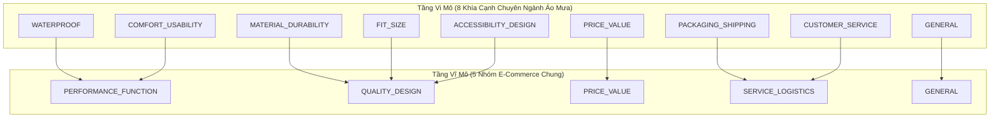

# Hướng Dẫn Gán Nhãn Phản Hồi Khách Hàng (ABSA Annotation Guideline)

> **Dự án:** EcomReview AI — Phân tích phản hồi khách hàng & Lập kế hoạch hành động  
> **Phiên bản:** 1.1.0 (Cập nhật Tuần 2 · Bổ sung quy tắc xử lý thực tế shop áo mưa & hướng dẫn template)  
> **Áp dụng cho:** Tập dữ liệu Đánh giá Sản phẩm TMĐT & Case Study Shop Áo Mưa  

---

## 1. Mục Đích & Nguyên Tắc Cốt Lõi

Tài liệu này quy chuẩn hóa quy trình gán nhãn Phân tích Cảm xúc theo Khía cạnh (Aspect-Based Sentiment Analysis - ABSA) tiếng Việt. Bộ quy tắc này là căn cứ tối cao nhằm:
1. Đảm bảo tính nhất quán (Inter-annotator & Intra-annotator Agreement) giữa con người và mô hình, đo lường bằng hệ số Cohen's Kappa / Fleiss' Kappa ($\kappa \ge 0.70$).
2. Thiết lập tập dữ liệu vàng (Gold Standard Dataset) phục vụ huấn luyện và kiểm thử RQ1, RQ2 và RQ3.
3. Cố định bộ tiêu chuẩn trích xuất bằng chứng (Evidence Extraction) cho các mô hình ngôn ngữ lớn.

---

## 2. Hệ Thống Taxonomy Khía Cạnh Hai Tầng (Two-Tier Taxonomy)

Để giải quyết bài toán chuyển miền (Domain Shift) và đối sánh công bằng giữa tập Benchmark công khai và tập dữ liệu Shop Áo Mưa, hệ thống sử dụng kiến trúc phân loại 2 tầng:



### Bảng Ánh Xạ & Định Nghĩa Chi Tiết 8 Khía Cạnh (FineAspects)

| Mã Khía Cạnh | Nhóm Vĩ Mô | Định Nghĩa & Phạm Vi | Ví Dụ Tích Cực (`positive`) | Ví Dụ Tiêu Cực (`negative`) |
| :--- | :--- | :--- | :--- | :--- |
| **`WATERPROOF`** | `PERFORMANCE_FUNCTION` | Khả năng chống thấm nước, độ kín của đường may ép nhiệt, độ che chắn khi mưa lớn, tràn nước qua cổ/dây kéo. | *"mưa to 30p không thấm giọt nào", "chống nước cực tốt"* | *"đi mưa 10p là ướt sũng vai", "nước ngấm qua đường chỉ may"* |
| **`MATERIAL_DURABILITY`** | `QUALITY_DESIGN` | Chất liệu vải (dù, PVC, da cá, tráng PU), độ dày/mỏng, mùi nhựa, độ bền đường may, cúc bấm, khóa kéo rách/kẹt/hỏng. | *"vải da cá dày dặn mềm mịn, cúc bấm chắc chắn"* | *"vải mỏng như túi bóng, rách nách", "kéo con rít bị kẹt răng"* |
| **`FIT_SIZE`** | `QUALITY_DESIGN` | Độ vừa vặn của bảng size, chiều dài che chân, độ rộng che balo/người ngồi sau, độ dài ống tay. | *"size 2XL rộng rãi, trùm kín cả balo to", "1m72 68kg vừa in"* | *"áo quá ngắn ngồi xe nước bắn ướt hết chân", "ống tay ngắn củn"* |
| **`COMFORT_USABILITY`** | `PERFORMANCE_FUNCTION` | Độ tiện dụng khi mặc/cởi, độ thoáng khí vs hầm bí mồ hôi, độ gập gọn bỏ cốp xe, kính chắn mưa, bao gương. | *"áo nhẹ, gấp lại bỏ vừa cốp xe", "kính chắn mưa trong suốt rất tiện"* | *"mặc vào bí bách chảy mồ hôi như xông hơi", "kính mờ đục lóa đèn"* |
| **`ACCESSIBILITY_DESIGN`** | `QUALITY_DESIGN` | Tính thẩm mỹ, màu sắc, kiểu dáng thời trang, họa tiết, tính thời thượng tổng thể. | *"màu xanh rêu đẹp y như hình chụp", "form áo thời trang"* | *"giao sai màu, bên ngoài nhìn dại hơn trong ảnh quảng cáo"* |
| **`PRICE_VALUE`** | `PRICE_VALUE` | Giá thành, độ đáng tiền (Value for money), tính kinh tế so với chất lượng nhận được. | *"giá 150k quá hời so với chất lượng", "đáng tiền nên mua nhé"* | *"bán 250k mà chất lượng thua hàng chợ 50k", "quá đắt"* |
| **`PACKAGING_SHIPPING`** | `SERVICE_LOGISTICS` | Tốc độ giao hàng, đóng gói hộp/túi khi nhận, thái độ shipper giao hàng. | *"đặt tối qua trưa nay đã nhận được, bọc hàng kỹ"* | *"giao hàng chậm gần 1 tuần, túi bọc rách nát"* |
| **`CUSTOMER_SERVICE`** | `SERVICE_LOGISTICS` | Dịch vụ tư vấn của shop, phản hồi tin nhắn chat, giải quyết khiếu nại đổi trả. | *"shop tư vấn size rất chuẩn và nhiệt tình", "hỗ trợ đổi áo mới ngay"* | *"nhắn tin hỏi không thèm trả lời", "shop vô trách nhiệm khi hàng lỗi"* |
| **`GENERAL`** | `GENERAL` | Cảm xúc hoặc nhận xét chung chung không đề cập cụ thể đến bất kỳ khía cạnh kỹ thuật nào ở trên. | *"sản phẩm tốt, cho shop 5 sao", "ưng ý lắm"* | *"quá tệ, thất vọng tràn trề", "không nên mua"* |

---

## 3. Quy Tắc Gán Nhãn Bắt Buộc (Annotation Rules)

### Quy tắc 1: Cấu trúc Đầu Ra Nhất Quán
Mỗi phản hồi khách hàng được phân tích thành:
- `overall_sentiment` $\in \{\text{positive}, \text{negative}, \text{neutral}\}$: Cảm xúc chủ đạo toàn bài.
- `opinions`: Danh sách các nhận định khía cạnh. Mỗi nhận định gồm:
  - `aspect`: Thuộc một trong 8 khía cạnh chuẩn hoặc `GENERAL`.
  - `polarity` $\in \{\text{positive}, \text{negative}, \text{neutral}\}$.
  - `evidence`: Trích dẫn **NGUYÊN VĂN** từ đánh giá gốc làm bằng chứng (độ dài 1–15 từ). Tuyệt đối không tự suy diễn hoặc sửa đổi từ ngữ.
- `informative` $\in \{\text{True}, \text{False}\}$: Cờ xác định giá trị thông tin.

### Quy tắc 2: Phân Biệt Cờ `informative` (Hữu Ích vs Đánh Giá Cụt/Spam)
- **`informative = False`** khi phản hồi:
  1. Chỉ chứa các từ khen/chê cụt lủn không có thông tin sản phẩm (Ví dụ: *"ok"*, *"tốt"*, *"hàng dùng được"*, *"5 sao"*, *"đã nhận hàng"*).
  2. Đoạn văn spam nhận xu, chép lời bài hát, chuỗi ký tự vô nghĩa (Ví dụ: *"kjajajsjsjwjjwjsjjsjsjsjsjsjsjsjsjej"*).
  3. Chỉ có biểu tượng cảm xúc (emoji).
- **`informative = True`** khi phản hồi đề cập ít nhất 1 khía cạnh thuộc 8 khía cạnh chuyên sâu (`WATERPROOF`, `MATERIAL_DURABILITY`, `FIT_SIZE`, v.v.).

### Quy tắc 3: Xử Lý Hiện Tượng Mỉa Mai (Sarcasm / Irony)
Gán nhãn theo **ý đồ thực tế của người dùng**, không gán theo nghĩa đen mặt chữ:
- *Ví dụ:* *"Áo chống thấm tốt ghê, mưa phùn 5 phút ướt sũng cả quần trong"*  
  $\rightarrow$ `aspect`: `WATERPROOF`, `polarity`: `negative`, `evidence`: *"mưa phùn 5 phút ướt sũng"*.

### Quy tắc 4: Tiếng Lóng Miền Nam và Thuật Ngữ Đặc Thù Áo Mưa
- *"da cá"*: Ám chỉ chất liệu vải dù tráng nhựa dập nổi vân da cá (mềm mại, chống dính da) $\rightarrow$ gán `MATERIAL_DURABILITY`.
- *"con rít"* / *"kéo con rít"*: Khóa kéo (zipper) $\rightarrow$ gán `MATERIAL_DURABILITY`.
- *"kính chắn"* / *"mặt nạ"*: Tấm nhựa che mặt chống nước mưa văng vào mắt $\rightarrow$ gán `COMFORT_USABILITY`.
- *"bao kiếng xe"* / *"tay gương"*: Phần xẻ hoặc bọc che gương chiếu hậu $\rightarrow$ gán `COMFORT_USABILITY`.

---

## 4. Hướng Dẫn Thao Tác Gán Nhãn Lượt 1 (Task 2.3 Cho Người Nghiên Cứu)

1. Mở file template tại: `data/gold/annotation_template_125_real.xlsx` hoặc `.csv`.
2. Hệ thống đã trích xuất sẵn 125 nhận xét văn bản thực tế kèm các gợi ý nhãn tự động (`suggested_opinions`).
3. Nhiệm vụ của bạn:
   - Đọc cột `text` của từng dòng.
   - Kiểm tra và chỉnh sửa cột `overall_sentiment` (`positive`, `negative`, hoặc `neutral`).
   - Kiểm tra cột `opinions`: sửa lại dạng `ASPECT#POLARITY#EVIDENCE` nếu gợi ý chưa chính xác (nhiều khía cạnh cách nhau bằng dấu chấm phẩy `;`).
   - Đặt `informative` bằng `1` (nếu có thông tin chi tiết) hoặc `0` (nếu chỉ là review cụt lủn).
4. Lưu file lại. Sau đó chạy lệnh khóa tập test:
   ```bash
   .venv\Scripts\python scripts/process_gold_annotations.py
   ```
5. Hệ thống sẽ tự động cập nhật `dev.jsonl`, `test_locked.jsonl` và tái tính mã băm SHA-256 an toàn.

<!-- CreBy: MenBoyBMN -->
