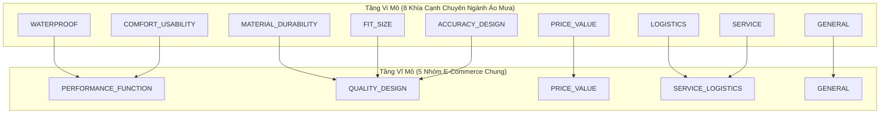

# Hướng Dẫn Gán Nhãn Phản Hồi Khách Hàng (ABSA Annotation Guideline)

> **Dự án:** EcomReview AI — Phân tích phản hồi khách hàng & Lập kế hoạch hành động  
> **Phiên bản:** 1.0.0 (Đóng băng Taxonomy v1.0)  
> **Áp dụng cho:** Tập dữ liệu Đánh giá Sản phẩm TMĐT & Case Study Shop Áo Mưa  

---

## 1. Mục Đích & Nguyên Tắc Cốt Lõi

Tài liệu này quy chuẩn hóa quy trình gán nhãn Phân tích Cảm xúc theo Khía cạnh (Aspect-Based Sentiment Analysis - ABSA) tiếng Việt. Bộ quy tắc này là căn cứ tối cao nhằm:
1. Đảm bảo tính nhất quán (Inter-annotator Agreement) giữa con người và mô hình, đo lường bằng hệ số Cohen's Kappa / Fleiss' Kappa ($\kappa \ge 0.75$).
2. Thiết lập tập dữ liệu vàng (Gold Standard Dataset) phục vụ huấn luyện và kiểm thử RQ1, RQ2 và RQ3.
3. Cố định bộ tiêu chuẩn trích xuất bằng chứng (Evidence Extraction) cho các mô hình ngôn ngữ lớn.

---

## 2. Hệ Thống Taxonomy Khía Cạnh Hai Tầng (Two-Tier Taxonomy)

Để giải quyết bài toán chuyển miền (Domain Shift) và đối sánh công bằng giữa tập Benchmark công khai và tập dữ liệu Shop Áo Mưa, hệ thống sử dụng kiến trúc phân loại 2 tầng:

### Bảng Ánh Xạ & Định Nghĩa Chi Tiết 8 Khía Cạnh (FineAspects)

| Mã Khía Cạnh | Nhóm Vĩ Mô | Định Nghĩa & Phạm Vi | Ví Dụ Tích Cực (`positive`) | Ví Dụ Tiêu Cực (`negative`) |
| :--- | :--- | :--- | :--- | :--- |
| **`WATERPROOF`** | `PERFORMANCE_FUNCTION` | Khả năng chống thấm nước, độ kín của đường may ép nhiệt, độ che chắn khi mưa lớn, tràn nước qua cổ/dây kéo. | *"mưa to 30p không thấm giọt nào", "chống nước cực tốt"* | *"đi mưa 10p là ướt sũng vai", "nước ngấm qua đường chỉ may"* |
| **`MATERIAL_DURABILITY`** | `QUALITY_DESIGN` | Chất liệu vải (dù, PVC, tráng PU), độ dày/mỏng, mùi nhựa/mùi cao su, độ bền đường may, cúc bấm, khóa kéo rách/hỏng. | *"vải dù dày dặn, cúc bấm chắc chắn", "không có mùi hôi nhựa"* | *"vải mỏng như túi bóng, mặc 2 hôm rách nách", "mùi nhựa nồng nặc nhức đầu"* |
| **`FIT_SIZE`** | `QUALITY_DESIGN` | Độ vừa vặn của bảng size, chiều dài che chân, độ rộng che balo/người ngồi sau, độ dài ống tay. | *"size 2XL rộng rãi, trùm kín cả balo to", "vừa vặn người 1m75"* | *"áo quá ngắn ngồi xe nước bắn ướt hết chân", "ống tay bị chật khó cử động"* |
| **`COMFORT_USABILITY`** | `PERFORMANCE_FUNCTION` | Độ tiện dụng khi mặc/cởi, độ thoáng khí vs hầm bí mồ hôi, trọng lượng nhẹ, độ gập gọn bỏ cốp xe máy, kính chắn mưa. | *"áo nhẹ, gấp lại bỏ vừa cốp xe", "kính chắn mưa trong suốt rất tiện"* | *"mặc vào bí bách chảy mồ hôi như xông hơi", "áo nặng trịch cồng kềnh"* |
| **`ACCURACY_DESIGN`** | `QUALITY_DESIGN` | Tính thẩm mỹ, màu sắc, kiểu dáng, độ khớp thực tế so với hình ảnh/video mô tả gian hàng. | *"màu xanh rêu đẹp y như hình chụp", "form áo thời trang"* | *"giao sai màu, bên ngoài nhìn dại hơn trong ảnh quảng cáo"* |
| **`PRICE_VALUE`** | `PRICE_VALUE` | Giá thành, độ đáng tiền (Value for money), khuyến mãi/voucher, tính kinh tế so với chất lượng. | *"giá 150k quá hời so với chất lượng", "đáng tiền nên mua nhé"* | *"bán 250k mà chất lượng thua hàng chợ 50k", "quá đắt so với vải này"* |
| **`LOGISTICS`** | `SERVICE_LOGISTICS` | Tốc độ đóng gói, thời gian giao hàng của đơn vị vận chuyển, tình trạng vỏ hộp/túi khi nhận, thái độ shipper. | *"đặt tối qua trưa nay đã nhận được, bọc hàng kỹ"* | *"giao hàng chậm gần 1 tuần, túi bọc rách nát"* |
| **`SERVICE`** | `SERVICE_LOGISTICS` | Dịch vụ chăm sóc khách hàng: tư vấn chọn size, thái độ phản hồi tin nhắn của shop, xử lý đổi trả hàng lỗi. | *"shop tư vấn size rất chuẩn và nhiệt tình", "hỗ trợ đổi áo mới ngay lập tức"* | *"nhắn tin hỏi không thèm trả lời", "shop thái độ vô trách nhiệm khi hàng lỗi"* |
| **`GENERAL`** | `GENERAL` | Cảm xúc hoặc nhận xét chung chung không đề cập cụ thể đến bất kỳ khía cạnh kỹ thuật nào ở trên. | *"sản phẩm tốt, cho shop 5 sao", "ưng ý lắm"* | *"quá tệ, thất vọng tràn trề", "không nên mua"* |

---

## 3. Quy Tắc Gán Nhãn Bắt Buộc (Annotation Rules)

### Quy tắc 1: Cấu trúc Đầu Ra Nhất Quán
Mỗi phản hồi khách hàng được phân tích thành:
- `overall_sentiment` $\in \{\text{positive}, \text{negative}, \text{neutral}\}$: Cảm xúc chủ đạo toàn bài.
- `opinions`: Danh sách 0, 1 hoặc nhiều nhận định khía cạnh. Mỗi nhận định gồm:
  - `aspect`: Thuộc một trong 8 khía cạnh chuẩn hoặc `GENERAL`.
  - `polarity` $\in \{\text{positive}, \text{negative}, \text{neutral}\}$.
  - `evidence`: Trích dẫn **NGUYÊN VĂN** từ đánh giá gốc làm bằng chứng (độ dài 1–15 từ). Tuyệt đối không diễn giải hoặc sửa từ.
- `informative` $\in \{\text{True}, \text{False}\}$: Cờ xác định giá trị thông tin.

### Quy tắc 2: Phân Biệt Cờ `informative` (Hữu Ích vs Rác/Spam)
- **`informative = False`** khi phản hồi:
  1. Chỉ chứa các từ khen/chê cụt lủn không có thông tin sản phẩm (Ví dụ: *"ok"*, *"hàng dùng được"*, *"good"*, *"5 sao"*).
  2. Đoạn văn spam nhận xu, copy lời bài hát, chép công thức nấu ăn, chuỗi ký tự vô nghĩa (Ví dụ: *"kskdkfjfksl"*).
  3. Chỉ có biểu tượng cảm xúc (emoji) hoặc hình ảnh/video không có chữ đi kèm.
- **`informative = True`** khi phản hồi đề cập ít nhất 1 khía cạnh thuộc 8 khía cạnh chuyên sâu (`WATERPROOF`, `MATERIAL_DURABILITY`, `FIT_SIZE`, v.v.).

### Quy tắc 3: Xử Lý Hiện Tượng Mỉa Mai (Sarcasm / Irony)
Gán nhãn theo **ý đồ thực tế của người dùng**, không gán theo nghĩa mặt chữ:
- *Ví dụ:* *"Áo chống thấm tốt ghê, mưa phùn 5 phút ướt sũng cả quần trong"*  
  $\rightarrow$ `aspect`: `WATERPROOF`, `polarity`: `negative`, `evidence`: *"mưa phùn 5 phút ướt sũng"*.

### Quy tắc 4: Giải Quyết Các Ca Nhập Nhằng Ranh Giới (Boundary Cases)

1. **`WATERPROOF` vs `MATERIAL_DURABILITY`:**
   - Khi phản hồi nhắc đến đường may bị dột/ngấm nước: Ưu tiên gán `WATERPROOF` (vì đây là công năng chống thấm).
   - Khi phản hồi nhắc đến đường may bị bung chỉ, rách, tuột đường ép nhiệt: Gán `MATERIAL_DURABILITY`.
   - Nếu khách hàng nói: *"Đường may ẩu bị rách làm nước ngấm vào"*: Gán **cả hai** khía cạnh.
2. **`FIT_SIZE` vs `COMFORT_USABILITY`:**
   - Đánh giá về số đo, chiều dài, che phủ, độ rộng trùm balo: Gán `FIT_SIZE`.
   - Đánh giá về cảm giác mặc (hầm bí, nhẹ, nặng, thoáng khí, khó cởi): Gán `COMFORT_USABILITY`.
3. **`LOGISTICS` vs `SERVICE`:**
   - Thời gian vận chuyển, đóng gói, tài xế giao hàng: Gán `LOGISTICS`.
   - Tư vấn của gian hàng, phản hồi tin nhắn chat, chính sách giải quyết khiếu nại: Gán `SERVICE`.

---

## 4. Bộ 15 Mẫu Gán Nhãn Thực Nghiệm Chuẩn (Gold Reference Samples)

| # | Nội Dung Phản Hồi Gốc | Overall | Opinions `[Aspect \| Polarity \| Evidence]` | Informative |
|---|---|---|---|---|
| 1 | *"Áo dày dặn, đi mưa to 30p không thấm, shop giao nhanh"* | `positive` | `[MATERIAL_DURABILITY \| positive \| "Áo dày dặn"]`, `[WATERPROOF \| positive \| "đi mưa to 30p không thấm"]`, `[LOGISTICS \| positive \| "shop giao nhanh"]` | `True` |
| 2 | *"Mua áo mưa mà mặc vào ngỡ đang xông hơi, bí bách kinh khủng, vải mỏng tang"* | `negative` | `[COMFORT_USABILITY \| negative \| "mặc vào ngỡ đang xông hơi, bí bách kinh khủng"]`, `[MATERIAL_DURABILITY \| negative \| "vải mỏng tang"]` | `True` |
| 3 | *"1m75 nặng 75kg mặc size 3XL hơi ngắn chân, ngồi xe số nước tạt ướt giày"* | `negative` | `[FIT_SIZE \| negative \| "hơi ngắn chân, ngồi xe số nước tạt ướt giày"]` | `True` |
| 4 | *"ok shop nhận đc hàng rồi nha"* | `positive` | `[GENERAL \| positive \| "ok shop"]` | `False` |
| 5 | *"Sản phẩm giống hình, màu tím than rất ưng, có kính chắn gương xe tiện lợi"* | `positive` | `[ACCURACY_DESIGN \| positive \| "Sản phẩm giống hình, màu tím than rất ưng"]`, `[COMFORT_USABILITY \| positive \| "kính chắn gương xe tiện lợi"]` | `True` |
| 6 | *"Chất lượng tuyệt vời quá, đi mưa 10 phút áo ướt nhẹp bên trong, lạy shop"* | `negative` | `[WATERPROOF \| negative \| "đi mưa 10 phút áo ướt nhẹp bên trong"]` | `True` |
| 7 | *"Hàng giao đúng hẹn. Giá 180k hơi cao nhưng chất vải dù này chắc dùng bền"* | `positive` | `[LOGISTICS \| positive \| "Hàng giao đúng hẹn"]`, `[PRICE_VALUE \| negative \| "Giá 180k hơi cao"]`, `[MATERIAL_DURABILITY \| positive \| "chất vải dù này chắc dùng bền"]` | `True` |
| 8 | *"Shop đóng gói cẩn thận, bọc 2 lớp túi, có tặng kèm túi rút đựng áo rất xịn"* | `positive` | `[LOGISTICS \| positive \| "đóng gói cẩn thận, bọc 2 lớp túi"]`, `[CUSTOMER_SERVICE \| positive \| "tặng kèm túi rút đựng áo rất xịn"]` | `True` |
| 9 | *"Nhắn tin đổi size do chật mà 3 ngày không trả lời, làm ăn tắc trách"* | `negative` | `[CUSTOMER_SERVICE \| negative \| "Nhắn tin đổi size do chật mà 3 ngày không trả lời"]` | `True` |
| 10 | *"Mùi nhựa nồng nặc mở túi ra nhức cả đầu, phải phơi 3 ngày mới hết"* | `negative` | `[MATERIAL_DURABILITY \| negative \| "Mùi nhựa nồng nặc mở túi ra nhức cả đầu"]` | `True` |
| 11 | *"Tốt"* | `positive` | `[GENERAL \| positive \| "Tốt"]` | `False` |
| 12 | *"Mua đợt sale 99k, quá đáng tiền, sẽ ủng hộ tiếp"* | `positive` | `[PRICE_VALUE \| positive \| "Mua đợt sale 99k, quá đáng tiền"]` | `True` |
| 13 | *"Giao sai màu, đặt xanh rêu giao màu hồng cánh sen, bực mình ghê"* | `negative` | `[ACCURACY_DESIGN \| negative \| "Giao sai màu, đặt xanh rêu giao màu hồng cánh sen"]` | `True` |
| 14 | *"Áo nhẹ tênh, gấp gọn bằng bàn tay để vừa cốp xe Vision, rất tiện"* | `positive` | `[COMFORT_USABILITY \| positive \| "Áo nhẹ tênh, gấp gọn bằng bàn tay để vừa cốp xe Vision"]` | `True` |
| 15 | *"Khóa kéo kéo lên bị kẹt rách cả mép áo, đường may cẩu thả"* | `negative` | `[MATERIAL_DURABILITY \| negative \| "Khóa kéo kéo lên bị kẹt rách cả mép áo, đường may cẩu thả"]` | `True` |

<!-- CreBy: MenBoyBMN -->
