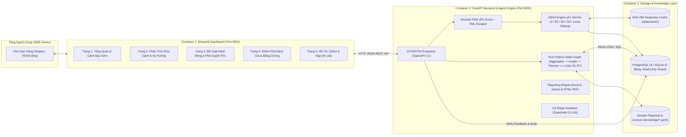
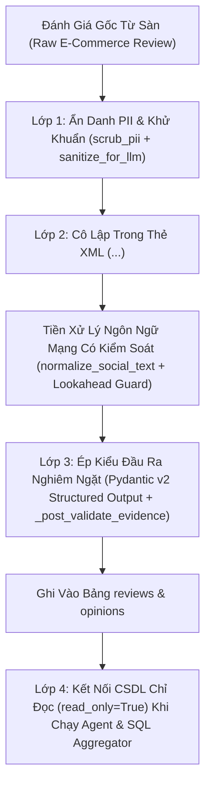
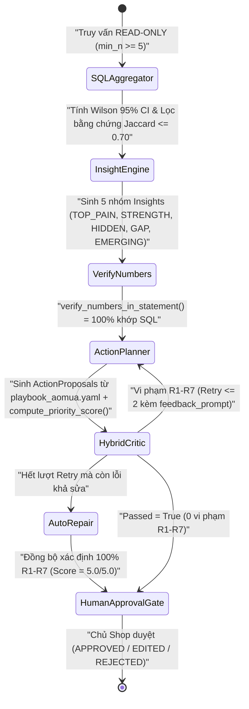
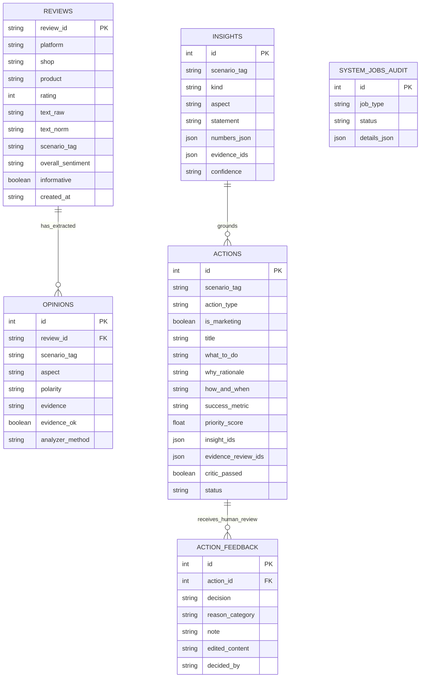

# Tài Liệu Kiến Trúc Hệ Thống EcomReview AI (`System Architecture & ADR`)

Tài liệu này mô tả chi tiết kiến trúc kỹ thuật của hệ thống **EcomReview AI** qua **4 sơ đồ kiến trúc chuẩn** (Container 3 tầng, Pipeline Dữ liệu & Bảo mật 4 lớp, Đồ thị Trạng thái Tác tử `Pure Python State-Graph`, và Sơ đồ Quan hệ Thực thể CSDL 6 bảng) cùng **Bảng Quyết định Kiến trúc (`Architecture Decision Records — ADR`)**.

---

## 1. Sơ Đồ Kiến Trúc Container 3 Tầng (`3-Tier Container Architecture`)

---

## 2. Luồng Dữ Liệu & Phòng Thủ Bảo Mật 4 Lớp (`4-Layer Defense-in-Depth Pipeline`)

Đánh giá từ khách hàng trên sàn thương mại điện tử là dữ liệu ngoại vi không đáng tin cậy (`Untrusted External Input`). Hệ thống áp dụng 4 lớp bảo vệ tuần tự trước và sau khi tương tác với LLM:

---

## 3. Đồ Thị Trạng Thái Tác Tử Thuần Python (`Pure Python State-Graph & HybridCritic R1–R7`)

### Bảng 7 Quy Tắc Xác Định Trong `HybridCritic` (`src/ecomreview/agent/critic.py`):
- **`R1 (Evidence Existence)`:** Mỗi hành động phải tham chiếu `insight_ids` hợp lệ và gắn kèm $\ge 2$ mã `evidence_review_ids` có thật trong CSDL.
- **`R2 (Numeric Grounding)`:** Mọi con số thống kê trong `why_rationale` phải khớp 100% với số liệu SQL của Insight được tham chiếu (`verify_numbers_in_statement`).
- **`R3 (Action Completeness & Deadline)`:** Đầy đủ 4 thành phần (`what_to_do`, `why_rationale`, `how_and_when`, `success_metric`) và có từ khóa thời hạn thực hiện cụ thể (`24h`, `48h`, `ngày`, `tuần`).
- **`R4 (No Overclaiming)`:** Cấm tuyệt đối các cam kết quảng cáo quá đà ngành áo mưa (*"chống thấm 100%"*, *"chống nước tuyệt đối"*, *"vĩnh viễn không rách"*).
- **`R5 (Marketing Flag Sync)`:** Đồng bộ chính xác cờ `is_marketing = True` (`LISTING_UPDATE`, `CONTENT`, `REVIEW_REPLY`, `PROMOTION`, `CUSTOMER_CARE`) và `is_marketing = False` (`PRODUCT_FIX`, `OPS`).
- **`R6 (Anti-Duplication)`:** Độ tương đồng từ vựng Jaccard giữa mọi cặp đề xuất trong cùng kịch bản phải $\le 0.80$.
- **`R7 (Platform Policy Safety)`:** Cấm tuyệt đối các hành vi vi phạm chính sách sàn Shopee/TikTok (*"tặng tiền đổi 5 sao"*, *"xóa đánh giá 1 sao"*, *"chuyển khoản ngoài sàn"*).

---

## 4. Sơ Đồ Quan Hệ Thực Thể CSDL 6 Bảng (`Database ERD`)

---

## 5. Bảng Quyết Định Kiến Trúc (`Architecture Decision Records — ADR`)

| Mã ADR | Quyết Định Kỹ Thuật | Phương Án Thay Thế Đã Xét | Lý Do Lựa Chọn (`Rationale`) |
| :-: | :--- | :--- | :--- |
| **ADR-01** | **Pure Python State-Graph** thay vì LangChain / CrewAI | LangGraph, CrewAI, AutoGen | Loại bỏ hoàn toàn xung đột phiên bản phụ thuộc, kiểm soát 100% luồng retry/auto-repair xác định, dễ gỡ lỗi và độ trễ cực thấp (`< 80 ms` ở chế độ cache). |
| **ADR-02** | **SQL Aggregator + Wilson 95% CI** tính toán 100% số liệu trước LLM | Đưa toàn bộ review vào prompt để LLM tự đếm | Triệt tiêu 100% ảo giác số học (`Zero Numeric Hallucination`) và phản ánh trung thực độ bất định thống kê khi cỡ mẫu khía cạnh nhỏ. |
| **ADR-03** | **Hybrid Critic (7 Luật Python R1–R7 + Auto-Repair)** | Chỉ dùng LLM-as-a-Judge | Luật Python xác định bắt trúng 100% lỗi số học/chính sách trong `< 2 ms` với chi phí `$0.00`, không bị thiên kiến đồng thuận của LLM. |
| **ADR-04** | **Dual-Engine DB (PostgreSQL 16 + SQLite Fallback)** & `DEMO_CACHE_MODE` | Chỉ hỗ trợ PostgreSQL & bắt buộc gọi mạng | Đảm bảo hệ thống chạy mượt mà 100% cả trong môi trường Docker Production lẫn khi kiểm thử cục bộ / bảo vệ đồ án không cần Internet. |
| **ADR-05** | **Early Warning via Two-Proportion Z-Test** thay vì LLM Trend Detection | Cho LLM đọc bảng dữ liệu thời gian | Phát hiện bùng phát lỗi sản phẩm có ý nghĩa thống kê ($p < 0.05$), tránh báo động giả từ biến động ngẫu nhiên của các mẫu nhỏ. |
| **ADR-06** | **CS Reply Assistant với 6 Guardrails (G1–G6)** | Prompt LLM tự do sinh lời đáp | Đảm bảo phản hồi khách hàng 100% an toàn trước chính sách sàn Shopee/TikTok (chống hối lộ đổi sao, chống lộ hotline/kênh ngoài sàn, chống hứa hẹn tiền bồi hoàn vượt thẩm quyền). |

<!-- CreBy: MenBoyBMN -->

