# Bảng Tổng Hợp 20 Công Trình Khoa Học Liên Quan (Related Work Matrix)

> **Dự án:** EcomReview AI — Hệ thống AI Agent tự động phân tích phản hồi khách hàng tiếng Việt và đề xuất hành động marketing cho SMEs.  
> **Yêu cầu phục vụ:** Yêu cầu 2 Đề bài (15–25 công trình khoa học có DOI/nguồn xác minh).  
> **Thời điểm cập nhật:** Tuần 2 · Khóa khung lý thuyết và đối sánh nghiên cứu.

---

## 1. Bản Đồ Phân Nhóm 20 Công Trình Nghiên Cứu Cốt Lõi

```mermaid
graph TD
    A[Hệ Sinh Thái Nghiên Cứu EcomReview AI] --> B[Nhóm 1: Pretrained LM & NLP Tiếng Việt]
    A --> C[Nhóm 2: ABSA Datasets Tiếng Việt]
    A --> D[Nhóm 3: LLM & ABSA Nâng Cao]
    A --> E[Nhóm 4: Kiến Trúc AI Agent & Critic]
    A --> F[Nhóm 5: Groundedness & Actionable Mining]

    B --> B1[PhoBERT 2020]
    B --> B2[ViSoBERT 2023]
    B --> B3[VnCoreNLP 2018]
    B --> B4[VN Social Norm 2020]

    C --> C1[VLSP ABSA 2018]
    C --> C2[UIT-VSFC 2018]
    C --> C3[UIT-ViSFD 2021]
    C --> C4[UIT-ViSD4SA 2021]
    C --> C5[Biaffine ABSA 2021]

    D --> D1[Survey ABSA 2022]
    D --> D2[SentiEval 2024]
    D --> D3[ChatABSA 2024]
    D --> D4[BGE-M3 2024]
    D --> D5[SemEval-2016 T5]

    E --> E1[ReAct 2023]
    E --> E2[Self-Refine 2023]
    E --> E3[Reflexion 2023]
    E --> E4[LLM-as-a-Judge 2023]

    F --> F1[RAGAS 2024]
    F --> F2[Liu Review Mining 2020]
```

---

## 2. Bảng Đối Sánh Chi Tiết 20 Công Trình Khoa Học Liên Quan

| # | Tác giả & Năm | Bài toán nghiên cứu | Tập dữ liệu thực nghiệm | Phương pháp & Mô hình | Kết quả chính | Hạn chế chính | Điểm kế thừa & Khác biệt trong EcomReview AI |
|---|---|---|---|---|---|---|---|
| **[1]** | Nguyen & Nguyen (2020) | Pretrained LM cho tiếng Việt | 20GB văn bản báo chí tiếng Việt | RoBERTa architecture, Byte-pair encoding âm tiết | Đạt SOTA trên POS tagging, NER, NLI tiếng Việt lúc công bố | Huấn luyện chủ yếu trên văn bản chuẩn mực, kém thích ứng với teencode mạng xã hội | Kế thừa làm cơ sở đối sánh; chọn ViSoBERT thay vì PhoBERT cho văn bản TMĐT. |
| **[2]** | Nguyen et al. (2023) | Pretrained LM chuyên biệt mạng xã hội tiếng Việt | 11GB văn bản Facebook, TikTok, YouTube | XLM-RoBERTa base, tối ưu hóa từ vựng mạng xã hội tiếng Việt | Vượt trội PhoBERT trên 6 tác vụ NLP mạng xã hội tiếng Việt | Cần GPU huấn luyện/fine-tuning; chỉ phân loại tĩnh, không sinh hành động kinh doanh | **Baseline B3 cốt lõi** trong đồ án; so sánh trực tiếp với LLM Gemini Flash (RQ1). |
| **[3]** | Vu et al. (2018) | Công cụ tách từ & POS tagger tiếng Việt | Viet Treebank | MaxEnt Word Segmenter, RDRPOSTagger | Tốc độ xử lý nhanh, F1 tách từ đạt ~98% trên văn bản chuẩn | Dễ gãy khi gặp teencode, viết tắt, review không dấu | Sử dụng làm thành phần tách từ cho Baseline B2 (TF-IDF + Logistic Regression). |
| **[4]** | Nguyen et al. (2020) | Chuẩn hóa văn bản mạng xã hội tiếng Việt | Phản hồi Facebook tiếng Việt | Pipeline từ điển kết hợp mô hình seq2seq | Cải thiện độ chính xác phân loại cảm xúc khi có tiền xử lý | Cồng kềnh, độ trễ cao khi tích hợp vào hệ thống thời gian thực | Thiết kế module `normalize.py` tinh gọn bằng Regex + từ điển TMĐT thực chiến để đo Ablation (RQ2). |
| **[5]** | Nguyen et al. (2018) | ABSA Shared Task tiếng Việt đầu tiên | Phản hồi nhà hàng và khách sạn | Maximum Entropy, SVM truyền thống | Đặt nền móng benchmark ABSA cho cộng đồng nghiên cứu tiếng Việt | Quy mô nhỏ, chỉ bao gồm 2 miền truyền thống (nhà hàng, khách sạn) | Kế thừa taxonomy 4 cực tính và nguyên tắc đánh giá Aspect Macro F1. |
| **[6]** | Nguyen et al. (2018) | Phân tích cảm xúc sinh viên | 16.000 phản hồi đào tạo đại học | CNN, LSTM, SVM | Benchmark lớn về cảm xúc học đường tiếng Việt | Chỉ là phân loại cảm xúc cấp câu/văn bản, không phân tích khía cạnh (ABSA) | Kế thừa kinh nghiệm xây dựng bộ tiêu chí gán nhãn và đo độ đồng thuận Cohen's Kappa. |
| **[7]** | Luc Phan et al. (2021) | ABSA trên phản hồi TMĐT điện thoại (UIT-ViSFD) | 11.122 nhận xét mua điện thoại | Bi-LSTM + fastText, SA2SL Social Listening | F1 khía cạnh 84.48%, cảm xúc 63.06% | Chỉ dừng ở thống kê tỷ lệ hài lòng, không có Agent lập kế hoạch marketing | **Bộ dữ liệu Track 1 chuẩn** trong đồ án; chuẩn hóa sang 5 MacroAspects để đo Cross-Domain. |
| **[8]** | Nguyen et al. (2021) | Trích xuất span bằng chứng khía cạnh (UIT-ViSD4SA) | TMĐT tiếng Việt | PhoBERT-CRF, Span Extraction | Trích xuất chính xác ranh giới thực thể khía cạnh và cảm xúc | Mô hình cồng kềnh, yêu cầu gán nhãn BIO tốn nhiều công sức | Kế thừa ràng buộc trích dẫn bằng chứng `evidence` (1–15 từ) trong schema `AspectOpinion`. |
| **[9]** | Phan et al. (2021) | Mô hình ABSA liên kết bằng Biaffine Attention | UIT-ViSFD | Biaffine Scorer kết hợp PhoBERT | Nâng F1 sentiment lên 67.2% nhờ bắt cặp trực tiếp Aspect-Polarity | Đòi hỏi tài nguyên tính toán lớn, khó giải thích với chủ doanh nghiệp nhỏ | Đặt ra bài toán so sánh xem LLM Structured Output có vượt được Biaffine chuyên dụng không. |
| **[10]** | Zhang et al. (2022) | Khảo sát toàn diện bài toán ABSA | Tổng hợp 200+ công trình quốc tế | Tổng quan cấu trúc bài toán: ATE, ACD, ASC, E2E | Chuẩn hóa taxonomy và các độ đo F1, Accuracy cho bài toán ABSA | Chưa phân tích sâu về thế hệ LLM tự trị và AI Agent | Định hình khung lý thuyết cho Chương 2 và thiết lập công thức Macro F1 chuẩn mực. |
| **[11]** | Zhang et al. (2024) | Đánh giá năng lực LLM cho Sentiment (SentiEval) | Đa ngữ, đa tập dữ liệu | Zero-shot / Few-shot LLMs vs Fine-tuned Small LMs | Small LM fine-tuned vẫn cạnh tranh tốt với LLM trong miền hẹp | Không nghiên cứu về dữ liệu tiếng Việt mạng xã hội | Cảm hứng cho RQ1: Đặt ViSoBERT fine-tuned lên bàn cân đối đầu trực tiếp với Gemini Flash. |
| **[12]** | Bai et al. (2024) | Compound ABSA qua Prompting có cấu trúc (ChatABSA) | SemEval, Restaurant, Laptop | Ràng buộc cấu trúc qua Prompting | Giảm thiểu lỗi sai cú pháp khi trích xuất đa khía cạnh | Prompt thủ công bằng tiếng Anh, chưa phòng thủ Prompt Injection | Mở rộng thành Pydantic Schema-constrained Decoding kết hợp Defense-in-Depth phòng thủ injection. |
| **[13]** | Chen et al. (2024) | Embedding đa ngôn ngữ, đa chức năng (BGE-M3) | Đa ngữ quy mô lớn | Multi-task dense/sparse/ColBERT | Khả năng truy xuất ngữ nghĩa vượt trội trên văn bản tiếng Việt | Chỉ tạo vector, cần thêm tầng logic nghiệp vụ để ra quyết định | Ứng dụng trong việc tìm kiếm review bằng chứng tương đồng khi lập kế hoạch marketing. |
| **[14]** | Pontiki et al. (2016) | Khung tiêu chuẩn quốc tế cho bài toán ABSA | Nhà hàng, máy tính xách tay (EN, ES, FR...) | Benchmark cộng đồng SemEval Task 5 | Tiêu chuẩn vàng quốc tế cho mọi nghiên cứu ABSA hiện đại | Không có tiếng Việt; không đề cập đến bối cảnh kinh doanh thực tế của SMEs | Chuẩn hóa định nghĩa bộ 3 khía cạnh: `(Category, Polarity, Target/Evidence)`. |
| **[15]** | Yao et al. (2023) | Kiến trúc suy luận và hành động (ReAct) | HotpotQA, WebShop | Vòng lặp xen kẽ: Thought $\rightarrow$ Action $\rightarrow$ Observation | Cải thiện độ chính xác suy luận, giảm ảo giác trong tác vụ tra cứu | Dễ rơi vào vòng lặp vô tận (infinite loop), chi phí token cao | Tinh chỉnh thành State-Graph hữu hạn có chặn số vòng lặp tối đa (`max_retries=2`). |
| **[16]** | Madaan et al. (2023) | Tự hoàn thiện qua phản hồi (Self-Refine) | Lập trình, tóm tắt, hội thoại | Generator $\rightarrow$ Feedback $\rightarrow$ Refine | Nâng chất lượng đầu ra mà không cần huấn luyện lại trọng số mô hình | LLM tự phản biện chính mình dễ bị thiên vị xác nhận (self-confirmation) | **Cốt lõi cho Vòng lặp Agent:** Kết hợp 7 luật xác định (R1–R7) với LLM-Judge để phản biện khách quan. |
| **[17]** | Shinn et al. (2023) | Tác tử học củng cố bằng phản tư ngôn ngữ (Reflexion) | HumanEval, AlfWorld | Ghi nhớ phản tư bằng văn bản vào Semantic Memory | Đột phá khả năng tự sửa lỗi sau mỗi lần thử sai | Dựa hoàn toàn vào prompt tự nhiên, thiếu ràng buộc schema cứng | Ứng dụng nhật ký phản tư (trace logs JSON) ghi nhận lý do Critic từ chối đề xuất marketing. |
| **[18]** | Zheng et al. (2023) | Đánh giá độ tin cậy của LLM-as-a-Judge | MT-Bench, Chatbot Arena | So sánh đánh giá của LLM với chuyên gia con người | Độ đồng thuận giữa GPT-4 và con người đạt >80% | Thiên vị độ dài (verbosity), thiên vị thứ tự (position bias) | Thiết kế rubric định lượng chi tiết cho Critic Agent để loại bỏ thiên vị cảm tính. |
| **[19]** | Es et al. (2024) | Đo lường độ tin cậy tự động cho hệ RAG (RAGAS) | WikiEval, AmniEval | 3 tiêu chí: Faithfulness, Answer Relevance, Context Recall | Tiêu chuẩn đo lường tính căn cứ trong hệ sinh văn bản | Phục vụ bài toán RAG hỏi đáp, chưa tối ưu cho đề xuất hành động kinh doanh | Phát triển công thức **Groundedness Score** riêng cho `ActionProposal` (bắt buộc $\ge 2$ review dẫn chứng). |
| **[20]** | Liu, Bing (2020) | Nền tảng khai phá quan điểm và cảm xúc | Dữ liệu review Amazon, Yelp | Phân tích cảm xúc phục vụ Business Intelligence & Marketing | Cuốn sách giáo khoa kinh điển định hình toàn bộ lĩnh vực Sentiment Analysis | Các giải pháp trong sách dừng ở thống kê mô tả, thiếu cơ chế tự động sinh kế hoạch hành động | Cầu nối khoa học: Biến tri thức của Bing Liu thành hệ thống Agent hành động thực tiễn cho SMEs. |

---

## 3. Tổng Hợp Khoảng Trống Nghiên Cứu (Research Gaps)

Từ 20 công trình trên, EcomReview AI xác định rõ **3 khoảng trống khoa học chính**:

1. **Khoảng trống 1 (Về tính thích ứng & chuyển miền tiếng Việt):** Các mô hình tiền huấn luyện như ViSoBERT [2] tuy rất mạnh trên mạng xã hội nhưng chưa được kiểm chứng khả năng chuyển miền sang ngành hàng ngách (như áo mưa trên TikTok Shop). Chưa có nghiên cứu nào so sánh thực nghiệm đối đầu giữa Small LM fine-tuned và LLM thế hệ mới (Gemini Flash) có kiểm định Bootstrap CI 95%.
2. **Khoảng trống 2 (Từ trích xuất thông tin đến hành động kinh doanh):** 100% các công trình ABSA tiếng Việt trước đây ([5]–[9]) chỉ dừng lại ở việc gán nhãn tĩnh hoặc hiển thị biểu đồ thống kê đơn thuần. Hoàn toàn thiếu một tầng Agent có tri thức miền (`Playbook`) để chuyển hóa insight thành đề xuất hành động cụ thể cho SMEs.
3. **Khoảng trống 3 (Tính xác thực và độ tin cậy của Agent):** Các hệ thống Agent hiện đại ([15]–[17]) thường mắc lỗi ảo giác số liệu và tự phê bình thiếu tin cậy [18]. EcomReview AI giải quyết triệt để bằng nguyên tắc **Zero-Hallucination SQL Aggregator** kết hợp **Hybrid Critic** (7 luật xác định + LLM Judge).

<!-- CreBy: MenBoyBMN -->

