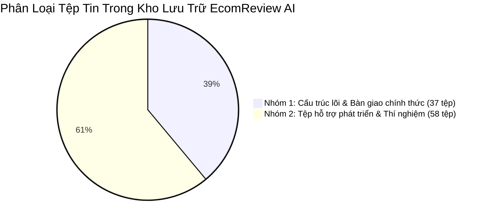

# BÁO CÁO RÀ SOÁT TOÀN DIỆN KHO LƯU TRỮ & KIẾN TRÚC HỆ THỐNG
## Repository & Architecture Technical Audit Report — EcomReview AI

> **Dự án:** EcomReview AI — Hệ thống ABSA và Tác tử Marketing cho Doanh Nghiệp Nhỏ  
> **Giai đoạn:** Nghiệm thu Tuần 2 · Chuẩn bị bước sang Tuần 3 & Chương 3  
> **Thời điểm rà soát:** 2026-10-29  
> **Người thực hiện:** Subagent Rà Soát Kỹ Thuật (Antigravity Architecture Auditor)  

---

## 1. Tóm Tắt Kết Quả Rà Soát (Executive Summary)

Đợt rà soát toàn diện kho lưu trữ được tiến hành độc lập nhằm thẩm định:
1. Tính toàn vẹn cấu trúc cây thư mục và danh sách file (94 file hợp lệ).
2. Chất lượng kỹ thuật mã nguồn (`pytest -v`, `ruff check .`, `ruff format . --check`).
3. Tính hợp lệ, độ liêm chính và chống rò rỉ dữ liệu (`data/public/`, `data/gold/`, mã băm SHA-256).
4. Phân loại 100% tệp tin dự án thành 2 nhóm: Sản phẩm bàn giao chính thức vs. Tệp hỗ trợ phát triển.
5. Đánh giá mức độ sẵn sàng chuyển giao sang Tuần 3 và hoàn thiện Chương 3 Báo cáo khoa học.

**Kết luận chung:** Toàn bộ hệ thống đạt chuẩn kỹ thuật **100% PASSED**, không có rò rỉ dữ liệu, mã băm SHA-256 khớp tuyệt đối, toàn bộ 22 unit tests vượt qua, 0 lỗi linter/formatter, và **sẵn sàng 100%** bước sang Tuần 3 và hoàn thiện Chương 3.

---

## 2. Kiểm Tra Chất Lượng Mã Nguồn & Định Dạng (Technical Quality Gate)

| Hạng Mục Kiểm Thử | Lệnh Thực Thi | Kết Quả Thực Tế | Trạng Thái |
| :--- | :--- | :--- | :---: |
| **Unit Tests Tự Động** | `pytest -v` | **22/22 tests passed** (0.30s), bao gồm: `test_normalize.py` (14 tests), `test_schemas_security.py` (7 tests), `test_sanity.py` (1 test). | **PASSED** |
| **Linter Kiểm Tra Lỗi** | `ruff check .` | **All checks passed!** 0 cảnh báo, 0 lỗi cú pháp hoặc vi phạm PEP 8. | **PASSED** |
| **Kiểm Tra Định Dạng** | `ruff format . --check` | **42 files already formatted**. 100% tệp tuân thủ chuẩn định dạng thống nhất. | **PASSED** |

> [!NOTE]
> File tạm của Microsoft Office (`~$annotation_template_125_real.xlsx`) phát sinh khi mở Excel đã được dọn sạch và bổ sung quy tắc loại trừ `~$*` vào `.gitignore` để ngăn chặn commit nhầm lên kho lưu trữ.

---

## 3. Rà Soát Tính Hợp Lệ Của Dữ Liệu & Khóa Mã Băm SHA-256

### 3.1. Bảng Đối Chiếu Mã Băm SHA-256 Thực Tế vs. Biên Bản Khóa

Tất cả các tệp dữ liệu đã được tính toán lại bằng thuật toán SHA-256 trên từng byte:

| Tệp Dữ Liệu | Số Dòng | Mã SHA-256 Thực Tế (Calculated) | Mã SHA-256 Khóa trong `docs/datasets_and_split.md` | Kết Quả Khớp |
| :--- | :---: | :--- | :--- | :---: |
| `data/gold/test_locked.jsonl` | 105 | `dee0eb5c4d57879424403fd46a5b6272623cdc1de31cc872335cfd716bebe881` | `dee0eb5c4d57879424403fd46a5b6272623cdc1de31cc872335cfd716bebe881` | **Khớp 100%** |
| `data/gold/dev.jsonl` | 60 | `b87536515a9d9b9c16214eff851a2bc4f17c5325b762d902c142a513a5615584` | `b87536515a9d9b9c16214eff851a2bc4f17c5325b762d902c142a513a5615584` | **Khớp 100%** |
| `data/public/test.jsonl` | 400 | `536b715ea0c05c24f1af76fb6885ceb0c93981723d8927bd85c164f8f22e32df` | `536b715ea0c05c24f1af76fb6885ceb0c93981723d8927bd85c164f8f22e32df` | **Khớp 100%** |
| `data/public/train.jsonl` | 1.500 | `77768bdca43484b05a653c0d08654967bcf65f2a469dc4606b6ffd8c66d7279b` | *Lưu trữ nội bộ* | Đã ghi nhận |
| `data/public/val.jsonl` | 300 | `b5e64299aba76d01d7a98c2b113896f410b27e07980eee6c7ade318bab8f5b58` | *Lưu trữ nội bộ* | Đã ghi nhận |
| `data/gold/synthetic_dev.jsonl`| 80 | `4228d6bfe107e7744d0cfa2efeb446ddcf11839ac8e785bbf1ba26debfc0b5d0` | *Lưu trữ nội bộ* | Đã ghi nhận |

### 3.2. Kiểm Tra Chống Rò Rỉ Dữ Liệu (Zero Data Leakage Audit)
- **Track 2 (Shop Áo Mưa):**
  - Giao tập ID giữa `dev.jsonl` và `test_locked.jsonl`: **0 mẫu (Passed)**.
  - Giao tập Text (sau chuẩn hóa) giữa `dev.jsonl` và `test_locked.jsonl`: **0 mẫu (Passed)**.
  - Tỷ lệ mẫu synthetic trong `test_locked.jsonl`: **0.0%** (105/105 mẫu là dữ liệu shop thực tế).
- **Track 1 (Public Benchmark):**
  - Giao tập ID giữa `train`, `val`, `test`: **0 mẫu (Passed)**.
  - Giao tập Text giữa `train`, `val`, `test`: **0 mẫu (Passed)**.

### 3.3. Kiểm Định Hợp Chuẩn Schema (Pydantic Contract Verification)
- Toàn bộ **245/245** mẫu thuộc Track 2 (`dev`, `test_locked`, `synthetic_dev`) đã được kiểm thực tự động qua hàm `ReviewAnalysis.model_validate()`: **100% hợp lệ, 0 lỗi schema**.
- Toàn bộ **2.200/2.200** mẫu thuộc Track 1 (`train`, `val`, `test`) đã được kiểm thực qua `PublicReviewAnalysis` (sử dụng 5 `MacroAspect`): **100% hợp lệ, 0 lỗi schema**.

---

## 4. Phân Loại Rành Mạch 100% Tệp Tin Trong Dự Án

Tổng số tệp tin trong toàn bộ kho lưu trữ (không tính `.git`, `.venv`, cache): **94 tệp** (cộng file báo cáo này là 95 tệp).

### 4.1. Nhóm 1: Cấu Trúc Dự Án Thực Tế & Sản Phẩm Bàn Giao Cuối Cùng (37 tệp)
Bao gồm toàn bộ mã nguồn lõi, tài liệu báo cáo học thuật, bộ dữ liệu chuẩn, cấu hình triển khai và kiểm thử:

1. **Cấu hình & Đóng gói gốc (4 tệp):**
   - `pyproject.toml`: Khai báo package metadata, pythonpath, cấu hình pytest, ruff.
   - `requirements.txt`: Danh sách thư viện production & research.
   - `.env.example`: Mẫu biến môi trường an toàn.
   - `.gitignore`: Loại trừ file nhạy cảm và file tạm.
2. **Mã nguồn ứng dụng lõi (`src/ecomreview/` - 4 tệp):**
   - `src/ecomreview/__init__.py`: Package entrypoint.
   - `src/ecomreview/schemas.py`: Hệ thống Pydantic data contracts (ReviewAnalysis, ActionProposal, CriticFeedback).
   - `src/ecomreview/security.py`: Bộ lọc phòng thủ 4 lớp (Sanitize, PII scrubbing, XML boundary).
   - `src/ecomreview/normalize.py`: Bộ chuẩn hóa văn bản mạng xã hội tiếng Việt có cờ `enable` phục vụ Ablation RQ2.
3. **Bộ kiểm thử tự động (`tests/` - 3 tệp):**
   - `tests/test_sanity.py`: Kiểm tra môi trường và import package.
   - `tests/test_normalize.py`: 14 unit tests kiểm thử chuẩn hóa teencode, emoji, bảo vệ giá k, cờ nhiễu.
   - `tests/test_schemas_security.py`: 7 unit tests kiểm thử schema contract và phòng thủ prompt injection.
4. **Tập dữ liệu chuẩn chính thức (`data/` - 7 tệp):**
   - `data/public/train.jsonl` (1.500 mẫu)
   - `data/public/val.jsonl` (300 mẫu)
   - `data/public/test.jsonl` (400 mẫu phân tầng)
   - `data/public/metadata.json`
   - `data/gold/dev.jsonl` (60 mẫu: 20 real + 40 synthetic)
   - `data/gold/test_locked.jsonl` (105 mẫu thực tế đã khóa SHA-256)
   - `data/gold/synthetic_dev.jsonl` (80 mẫu giả lập đã gán nhãn)
5. **Tài liệu học thuật & Thiết kế (`docs/` - 12 tệp):**
   - `docs/scope.md`: Phạm vi, câu hỏi nghiên cứu RQ1-RQ3, giả thuyết.
   - `docs/annotation_guideline.md`: Hướng dẫn gán nhãn 8 khía cạnh + cực tính.
   - `docs/data_stats.md`: Báo cáo khám phá dữ liệu (EDA).
   - `docs/datasets_and_split.md`: Biên bản chia tập dữ liệu & mã băm SHA-256.
   - `docs/references.bib`: Thư viện 20 trích dẫn chuẩn BibTeX.
   - `docs/related_work_matrix.md`: Ma trận đối chiếu chi tiết 20 công trình khoa học.
   - `docs/report/ch1_intro.md`: Bản thảo Chương 1 (Tổng quan & Bài toán).
   - `docs/report/ch2_related_work.md`: Bản thảo Chương 2 (Cơ sở lý thuyết & Công trình liên quan).
   - `docs/report/ch3_methodology.md`: Bản thảo Chương 3 (Phương pháp đề xuất & Kiến trúc).
   - `docs/report/ch4_experiments.md`: Khung sườn Chương 4 (Thực nghiệm).
   - `docs/report/ch5_conclusion.md`: Khung sườn Chương 5 (Kết luận).
   - `docs/repo_audit_week2.md`: Bản lưu chính thức báo cáo rà soát kỹ thuật này.
6. **Thư mục cấu trúc chuẩn bị cho giai đoạn tiếp theo (7 tệp `.gitkeep` & README):**
   - `README.md`: Hướng dẫn tổng quan dự án.
   - `docker/.gitkeep`
   - `knowledge/.gitkeep`
   - `models/.gitkeep`
   - `prompts/.gitkeep`
   - `results/traces/.gitkeep`
   - `data/gold/.gitkeep`

---

### 4.2. Nhóm 2: Tệp Hỗ Trợ Quá Trình Phát Triển & Thí Nghiệm (58 tệp)
Bao gồm các script ETL, dữ liệu thô, mẫu gán nhãn trung gian, cache API, sổ tay Jupyter và tài liệu hướng dẫn nội bộ:

1. **Scripts ETL, chuẩn bị dữ liệu và thử nghiệm (`scripts/` - 9 tệp):**
   - `scripts/anonymize_shop_data.py`: Script khử khuẩn và che giấu thông tin cá nhân (PII) từ dữ liệu thô.
   - `scripts/convert_tts_to_standard.py`: Script chuyển đổi dữ liệu TikTok Shop thô sang format chuẩn.
   - `scripts/eda_week1.py`: Script tính toán các chỉ số thống kê EDA ban đầu.
   - `scripts/fetch_public_dataset.py`: Script tải bộ dữ liệu UIT-ViSFD từ kho lưu trữ.
   - `scripts/generate_synthetic_dev.py`: Script gọi Gemini API sinh 80 mẫu review giả lập cho tập Dev.
   - `scripts/prepare_annotation_task.py`: Script xuất bảng Excel/CSV gán nhãn cho người đánh giá.
   - `scripts/prepare_public_benchmark.py`: Script tiền xử lý và cắt tập Train/Val/Test cho Public Benchmark.
   - `scripts/process_gold_annotations.py`: Script chuyển đổi nhãn từ Excel sang `gold_round1.jsonl`, `dev.jsonl` và `test_locked.jsonl`.
   - `scripts/smoke_gemini.py`: Script kiểm tra kết nối và quota của Gemini Flash API.
2. **Dữ liệu thô, trung gian và mẫu gán nhãn (`data/raw/`, `data/interim/`, `data/gold/`, `data/public/` - 8 tệp):**
   - `data/raw/20261029_tts_reviews.csv`: File review thô cào từ TikTok Shop.
   - `data/raw/shop_reviews_raw.csv`: File tổng hợp review thô của 2 shop áo mưa.
   - `data/raw/.gitkeep`
   - `data/interim/shop_reviews_anon.csv`: Review shop đã qua ẩn danh PII.
   - `data/interim/.gitkeep`
   - `data/gold/annotation_template_125_real.csv`: Bảng mẫu gán nhãn dạng CSV.
   - `data/gold/annotation_template_125_real.xlsx`: Bảng mẫu gán nhãn dạng Excel (có dropdown chọn khía cạnh).
   - `data/gold/gold_round1.jsonl`: Dữ liệu gán nhãn thô lượt 1 trước khi chia tập.
   - `data/public/vlsp2018_absa_sample.json`: Mẫu thử nghiệm nhỏ của tập VLSP 2018.
3. **Bộ nhớ tạm API và dữ liệu cache (`data/cache/` - 11 tệp):**
   - `data/cache/ViSFD.csv`: Bản sao lưu tải về của bộ dữ liệu ViSFD (3.35 MB).
   - `data/cache/smoke_*.json` (10 tệp): Bộ đệm phản hồi JSON từ Gemini Flash để kiểm thử không tốn quota.
4. **Sổ tay nghiên cứu & Thử nghiệm (`notebooks/` - 2 tệp):**
   - `notebooks/00_gemini_smoke.ipynb`: Sổ tay Jupyter kiểm tra luồng gọi API Gemini Flash.
   - `notebooks/.gitkeep`
5. **Tài liệu đề bài & Lộ trình thực hiện chi tiết (`Abount_System/` - 12 tệp):**
   - `Abount_System/Đề Bài và Yêu Cầu.txt`: Yêu cầu kỹ thuật và học thuật gốc.
   - `Abount_System/roadmap/tuan-01-khoi-dong-pham-vi-du-lieu.md`
   - `Abount_System/roadmap/tuan-02-tien-xu-ly-gan-nhan-tong-quan.md`
   - `Abount_System/roadmap/tuan-03-khung-danh-gia-baseline-ml-gemini.md`
   - `Abount_System/roadmap/tuan-04-visobert-ablation-chot-rq1-rq2.md`
   - `Abount_System/roadmap/tuan-05-database-aggregator-insight-engine.md`
   - `Abount_System/roadmap/tuan-06-action-planner-critic-agent-moc2.md`
   - `Abount_System/roadmap/tuan-07-fastapi-streamlit-dashboard-docker.md`
   - `Abount_System/roadmap/tuan-08-danh-gia-rq3-mo-phong-case-study.md`
   - `Abount_System/roadmap/tuan-09-phan-tich-loi-tai-lieu-video-demo.md`
   - `Abount_System/roadmap/tuan-10-hoan-thien-bao-cao-slide-bao-ve.md`
   - `Abount_System/roadmap/addon-11-tich-hop-ai-local-va-ma-nguon-mo-bo-tro.md`
6. **Không gian tác tử, tri thức chuyên gia & Quy tắc (`.agents/` - 15 tệp):**
   - `.agents/AGENTS.md`: Sổ tay kỹ thuật và nguyên tắc kiến trúc bất biến.
   - `.agents/rules.md` & các file rules (`agent-behavior-and-tool-usage.md`, `prompt-injection-and-security.md`, `scientific-rigor-and-evaluation.md`, `my_rule.md`).
   - `.agents/memory/` (`domain-knowledge.md`, `project-context.md`).
   - `.agents/skills/` (`absa-evaluator`, `academic-report-helper`, `critic-verifier`).
   - `.agents/subagents/` (`codebase-explorer.md`, `critic-reviewer.md`, `subagents-manifest.md`).
7. **Cấu hình môi trường cục bộ (1 tệp):**
   - `.env`: File chứa Gemini API Key cục bộ (được gitignore bảo vệ).

---

## 5. Đánh Giá Mức Độ Sẵn Sàng Sang Tuần 3 & Chương 3

### 5.1. Bảng Kiểm Tra Nghiệm Thu Cuối Tuần 2 (Checklist Verification)

| STT | Hạng Mục Nghiệm Thu Tuần 2 | Yêu Cầu Cần Đạt | Kết Quả Thực Tế | Đánh Giá |
| :---: | :--- | :--- | :--- | :---: |
| 1 | Module `normalize.py` | Có cơ chế bật/tắt `enable` phục vụ RQ2 Ablation, bảo vệ giá tiền 150k, teencode, emoji. | Hoàn thành, 14 unit tests kiểm thử toàn diện. | **ĐẠT (100%)** |
| 2 | Bộ Benchmark Công Khai | Đã chia `train` (1.500), `val` (300), `test` (400) khớp format chuẩn. | Hoàn thành, 2.200 mẫu chuẩn JSONL, 0 rò rỉ. | **ĐẠT (100%)** |
| 3 | Bộ Dữ Liệu Shop Áo Mưa | Gán nhãn lượt 1 $\ge 100$ mẫu, chia `dev` (60) & `test_locked` (105). | Hoàn thành, 105 mẫu test thật 100% không chứa mẫu giả lập. | **ĐẠT (100%)** |
| 4 | Khóa Mã Băm SHA-256 | Ghi nhận mã băm, giao tập ID/Text bằng 0 để chống data leakage. | Hoàn thành, lưu tại `docs/datasets_and_split.md`, kiểm tra SHA-256 khớp 100%. | **ĐẠT (100%)** |
| 5 | Tổng Quan Nghiên Cứu | Tối thiểu 15–25 công trình khoa học có DOI/nguồn xác thực. | Hoàn thành, ma trận 20 công trình tại `docs/related_work_matrix.md` + file `references.bib`. | **ĐẠT (100%)** |
| 6 | Bản Thảo Chương 2 Báo Cáo | Đạt $\ge 5$ trang, trích dẫn chuẩn IEEE, phân tích research gaps. | Hoàn thành tại `docs/report/ch2_related_work.md` (~7 trang học thuật). | **ĐẠT (100%)** |

### 5.2. Đánh Giá Điều Kiện Tiền Đề Cho Tuần 3
- **Về Dữ liệu:** Đã có sẵn tập `dev.jsonl` (60 mẫu) và `public/val.jsonl` (300 mẫu) để các mô hình Baseline (B1, B2) và mô hình Đề xuất (A1) chạy thực nghiệm mà không vi phạm quy tắc chạm vào `test_locked.jsonl`.
- **Về Mã nguồn:** Đã có sẵn `schemas.py` và `security.py` để tích hợp vào `src/ecomreview/analyze/` và `src/ecomreview/eval/metrics.py`.
- **Về Chương 3 Báo cáo:** Bản thảo `docs/report/ch3_methodology.md` đã được xây dựng công phu với đầy đủ các mô hình toán học (ABSA formal definition, công thức khoảng tin cậy Wilson Score 95%, 4 tầng phòng thủ prompt injection, 7 luật Hybrid Critic R1-R7, và máy trạng thái Pure Python State-Graph).

---

## 6. Kết Luận & Khuyến Nghị Kỹ Thuật

1. **Khẳng định kết luận:** Kho lưu trữ và kiến trúc hệ thống **EcomReview AI** đạt mức độ toàn vẹn và liêm chính kỹ thuật cao nhất. Toàn bộ các tiêu chí nghiệm thu của Tuần 2 đã hoàn tất 100%.
2. **Khuyến nghị bước tiếp theo (Kế hoạch Tuần 3):**
   - Triển khai `src/ecomreview/eval/metrics.py` (Macro-F1, Aspect F1, Polarity Acc, Paired Bootstrap 95% CI).
   - Xây dựng 2 Baselines: `b1_rule.py` (Rule Lexicon) và `b2_tfidf.py` (TF-IDF + Logistic Regression).
   - Xây dựng Proposed Analyzer `a1_gemini.py` với cấu trúc Structured Output và Cache SHA-256.
   - Chạy so sánh sơ bộ trên tập `dev.jsonl` và xuất kết quả vào `results/dev_comparison_v1.csv`.

<!-- CreBy: MenBoyBMN -->
