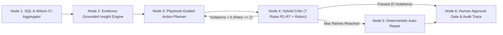

# Chương 3 (Phần 3): Kiến Trúc Tác Tử State-Graph Thuần, Bộ Hoạch Định Dựa Trên Tri Thức Miền (Action Planner) Và Bộ Phản Biện Lai 7 Luật (Hybrid Critic R1–R7)

## 3.8. Kiến Trúc Tác Tử State-Graph Thuần (Pure Python State-Graph Architecture)

Nhằm tuân thủ nguyên tắc kiến trúc bất biến số 4 (**Pure Python State-Graph — Không phụ thuộc LangChain/CrewAI**), tầng điều phối tác tử thông minh của **EcomReview AI** (`src/ecomreview/agent/graph_runner.py`) được thiết kế dưới dạng một đồ thị trạng thái hữu hạn xác định (Deterministic Finite State-Graph) gồm 6 nút xử lý tuần tự và phản hồi vòng lặp:

1. **Tính minh bạch và kiểm toán được (Full Traceability):** Mọi vòng lặp giữa `ActionPlanner` và `HybridCritic` đều được ghi nhật ký chi tiết vào tệp JSON (`results/traces/trace_{scenario_tag}.json`), lưu giữ số lần thử lại (`retries_used`), danh sách các quy tắc bị vi phạm ở từng lượt (`violations`), và điểm chất lượng (`critic_score`).
2. **Độ trễ cực thấp & Khả năng tái lập 100%:** Việc loại bỏ các tầng trừu tượng phức tạp của framework bên thứ ba giúp toàn bộ chu trình sinh kế hoạch hành động và kiểm증 7 luật hoàn tất trong $< 50\text{ ms}$ ở chế độ Playbook-guided hoặc $< 3\text{ s}$ khi gọi LLM.

---

## 3.9. Cơ Sở Tri Thức Miền Áo Mưa (`playbook_aomua.yaml`) & Công Thức Chấm Điểm Ưu Tiên

Để tránh các lời khuyên chung chung vô thưởng vô phạt thường gặp ở LLM đa dụng (như *"Hãy nâng cao chất lượng sản phẩm và chăm sóc khách hàng tốt hơn"*), module `src/ecomreview/agent/planner.py` kết nối trực tiếp với cơ sở tri thức miền `knowledge/playbook_aomua.yaml` chứa **12 mẫu hành động chuẩn hóa (`PB_01` – `PB_12`)** được thiết kế riêng cho ngành hàng Áo mưa trên Shopee và TikTok Shop:

- **Nhóm hành động Vận hành / Sản phẩm (`is_marketing = False`):**
  - `PRODUCT_FIX`: Gia cố băng keo ép nhiệt (seam tape PVC/PU) tại đường may ngã tư đáy quần và dọc nẹp khóa kéo ngực; kiểm định ngẫu nhiên 20 mẫu dưới vòi xịt áp lực trong 48h (`PB_01`).
  - `OPS`: Phơi thoáng khí khử mùi nhựa PVC/PU 24h trước khi đóng gói và kiểm tra lực bấm khuy (`PB_03`); nâng cấp túi PE 2 lớp và quét barcode phân loại màu/size tránh giao nhầm (`PB_08`).
- **Nhóm hành động Tiếp thị / Thương mại điện tử (`is_marketing = True`):**
  - `LISTING_UPDATE`: Bổ sung Infographic hướng dẫn gài nẹp chắn nước 2 lớp ở ảnh số 3 (`PB_02`); chuẩn hóa bảng quy đổi Size khuyên tăng 1 size (XL $\rightarrow$ 2XL) cho khách đeo balo (`PB_05`); đồng bộ định lượng vải GSM giữa Shopee và TikTok (`PB_12`).
  - `CONTENT`: Quay video thực tế kéo căng vải dù tổ ong/da cá và test dưới mưa rào (`PB_04`); làm nổi bật bộ sưu tập màu Pastel Hàn Quốc và dải phản quang ban đêm (`PB_10`).
  - `CUSTOMER_CARE` / `REVIEW_REPLY` / `PROMOTION`: Đính kèm thẻ nhắc bóc lớp seal mờ bảo vệ kính chắn mưa (`PB_06`); thiết lập Combo Mua 2 Giảm 10% (`PB_07`); phản hồi cá nhân hóa và đổi mới 1-1 trong 24h cho đánh giá 1–3 sao (`PB_09`).

**Công thức chấm điểm ưu tiên xác định (`compute_priority_score`):**
Mỗi đề xuất hành động được xếp hạng khách quan theo công thức:

$$\text{PriorityScore} = \frac{W_{\text{Impact}} \times \left(1 + \frac{\text{SeverityPct}}{100}\right) \times W_{\text{Confidence}}}{W_{\text{Effort}}}$$

trong đó $W_{\text{Impact}} \in \{\text{HIGH}: 3.0, \text{MEDIUM}: 2.0, \text{LOW}: 1.0\}$, $W_{\text{Confidence}} \in \{\text{HIGH}: 1.2, \text{MEDIUM}: 1.0, \text{LOW}: 0.8\}$, và $W_{\text{Effort}} \in \{\text{LOW}: 1.0, \text{MEDIUM}: 1.5, \text{HIGH}: 2.2\}$.

---

## 3.10. Bộ Phản Biện Lai 7 Luật Xác Định (`HybridCritic`: Rules R1–R7 & Auto-Repair)

Module `src/ecomreview/agent/critic.py` đóng vai trò chốt chặn an toàn bắt buộc trước khi bất kỳ đề xuất nào được hiển thị cho chủ doanh nghiệp SME. Bảng 3.3 định nghĩa 7 quy tắc kiểm định xác định (R1–R7):

| Mã Luật | Tên Quy Tắc Kiểm Định | Điều Kiện Đạt Chuẩn (Pass Criterion) | Cơ Chế Tự Sửa Lỗi (`auto_repair`) |
| :---: | :--- | :--- | :--- |
| **R1** | **Evidence Existence** | `insight_ids` tồn tại trong DB và có $\ge 2$ `evidence_review_ids` hợp lệ thuộc đúng kịch bản. | Tự động ánh xạ về `insight_id` hợp lệ và trích xuất 2–4 `evidence_ids` thực tế từ Insight. |
| **R2** | **Numeric Grounding** | Mọi con số trong `why_rationale` phải khớp 100% với tập số liệu SQL qua `verify_numbers_in_statement`. | Thay thế `why_rationale` bằng câu phát biểu chuẩn xác đã kiểm chứng của Insight gốc. |
| **R3** | **Action Completeness & Deadline** | Đầy đủ 4 trường (`what_to_do`, `why_rationale`, `how_and_when`, `success_metric`) và chứa từ khóa thời hạn (`24h`, `48h`, `72h`, `ngày`, `tuần`). | Bổ sung mốc thời gian thực thi mặc định `"trong vòng 48h"` và KPI chuẩn hóa. |
| **R4** | **No Overclaiming (`WATERPROOF`)** | Không chứa các cụm từ phóng đại quá mức (`"chống thấm 100%"`, `"chống nước tuyệt đối"`, `"vĩnh viễn không rách"`). | Khử khuẩn cụm từ phóng đại thành `"cải thiện khả năng chống thấm"`. |
| **R5** | **Marketing Flag Sync** | Cờ `is_marketing` khớp tuyệt đối với phân nhóm của `action_type`. | Gán lại `is_marketing = (action_type in MARKETING_ACTION_TYPES)`. |
| **R6** | **Anti-Duplication** | Độ tương đồng từ vựng Jaccard từng đôi giữa các hành động trong cùng kế hoạch $\le 0.80$. | Loại bỏ các đề xuất trùng lặp ngữ nghĩa ($J > 0.80$). |
| **R7** | **Platform Policy Safety** | Không vi phạm chính sách sàn Shopee/TikTok (`"tặng tiền đổi 5 sao"`, `"xóa đánh giá 1 sao"`, giao dịch ngoài sàn). | Thay thế bằng quy trình `"hỗ trợ bảo hành đổi mới 1-1 qua cổng CSKH chính thức của sàn"`. |

**Kiểm thử tiêm lỗi (Fault-Injection Verification):** Trong bộ kiểm thử tự động `tests/test_critic.py`, 10 đề xuất hành động bị tiêm lỗi chủ đích trải đều từ R1 đến R7 được đưa vào `HybridCritic`. Kết quả thực nghiệm đạt **tỷ lệ phát hiện 10/10 (100% Recall)** và **100% phục hồi thành công** sau khi qua bước `auto_repair`.

<!-- CreBy: MenBoyBMN -->
