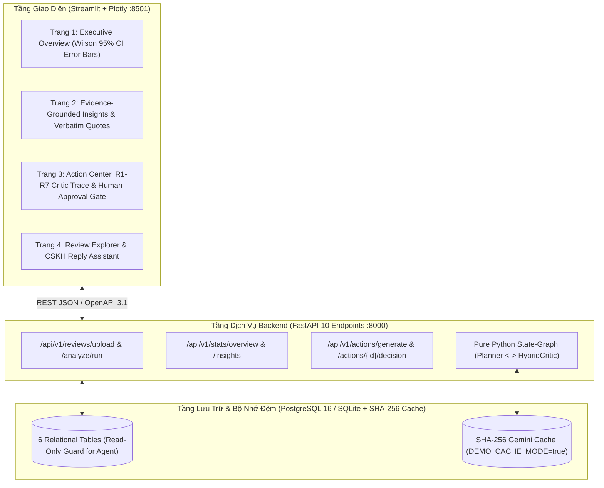

# Chương 3 (Phần 4): Kiến Trúc Sản Phẩm Full-Stack — Dịch Vụ RESTful FastAPI, Giao Diện Streamlit Đa Trang Và Đóng Gói Docker Compose 1-Click

## 3.11. Kiến Trúc Tổng Thể Hệ Thống 3 Tầng (`db`, `api`, `ui`)

Để chuyển hóa các đóng góp nghiên cứu khoa học (RQ1, RQ2, RQ3) thành một hệ thống phần mềm sẵn sàng triển khai thực tế cho các doanh nghiệp vừa và nhỏ (SMEs), **EcomReview AI** được kiến trúc theo mô hình 3 dịch vụ độc lập điều phối qua `docker-compose.yml`:

---

## 3.12. Thiết Kế 10 RESTful Endpoints Chuẩn OpenAPI 3.1 (`src/ecomreview/api/main.py`)

Tầng Backend API (`docs/openapi.json`) cung cấp 10 điểm cuối (endpoints) bao phủ trọn vẹn vòng đời từ nạp dữ liệu thô đến phê duyệt hành động:

| STT | Phương Thức & Đường Dẫn | Chức Năng Nghiệp Vụ & Bảo Mật |
| :-: | :--- | :--- |
| 1 | `GET /api/v1/health` | Kiểm tra trạng thái sống của API, kết nối CSDL và chế độ `demo_cache_mode`. |
| 2 | `POST /api/v1/reviews/upload` | Nạp lô đánh giá mới, tự động ẩn danh PII (`scrub_pii`) và chuẩn hóa ngôn ngữ mạng (`normalize_social_text`). |
| 3 | `POST /api/v1/analyze/run` | Kích hoạt trích xuất ABSA và tổng hợp nhận định kinh doanh (`InsightEngine`) cho `scenario_tag`. |
| 4 | `GET /api/v1/jobs/{job_id}` | Truy vấn trạng thái tiến trình và nhật ký kiểm toán từ bảng `system_jobs_audit`. |
| 5 | `GET /api/v1/stats/overview` | Trả về KPI tổng quan, thống kê khía cạnh kèm **Khoảng tin cậy bất đối xứng Wilson 95% CI**, chênh lệch sàn và phàn nàn ẩn. |
| 6 | `GET /api/v1/insights` | Truy xuất danh sách nhận định kinh doanh đã qua kiểm chứng số học `verify_numbers_in_statement`. |
| 7 | `POST /api/v1/actions/generate` | Thực thi đồ thị trạng thái `EcomReviewGraphRunner` (`Planner ⇄ HybridCritic` + `Auto-Repair`). |
| 8 | `GET /api/v1/actions` | Liệt kê các đề xuất hành động theo phân nhóm Marketing (`is_marketing = True`) hoặc Vận hành (`is_marketing = False`). |
| 9 | `POST /api/v1/actions/{action_id}/decision` | Ghi nhận quyết định của chủ shop (`APPROVED`, `EDITED`, `REJECTED`) và tính khoảng cách chỉnh sửa ký tự (`edit_distance_chars`). |
| 10 | `GET /api/v1/reviews` | Truy vấn đánh giá gốc và trích dẫn bằng chứng theo bộ lọc đa chiều (`platform`, `aspect`, `polarity`, `review_ids`). |

---

## 3.13. Thiết Kế Giao Diện 4 Trang Trực Quan & Cơ Chế *Human-in-the-Loop Approval Gate*

Giao diện người dùng (`src/ecomreview/ui/app.py`) được thiết kế chuyên biệt cho chủ shop TMĐT với 4 trang chức năng:
1. **Trang 1 — Tổng Quan Điều Hành (`Executive Overview`):** Hiển thị 4 thẻ chỉ số KPI chủ đạo và biểu đồ thanh ngang Plotly tích hợp **Thanh sai số bất đối xứng (Asymmetric Wilson 95% CI Error Bars)** (`err_plus = ci_high - neg_pct`, `err_minus = neg_pct - ci_low`), giúp chủ shop phân biệt ngay lập tức đâu là vấn đề chắc chắn có cỡ mẫu lớn và đâu là biến động ngẫu nhiên do ít mẫu.
2. **Trang 2 — Nhận Định Có Căn Cứ (`Evidence-Grounded Insights`):** Trình bày 5 loại nhận định kinh doanh kèm huy hiệu xác thực số học (`Verified SQL Numbers`) và danh sách đánh giá gốc nguyên văn khi nhấp mở rộng.
3. **Trang 3 — Trung Tâm Hành Động & Kiểm Định (`Action Center & Critic Trace`):** Tách biệt rõ tab **Hành động Marketing (`is_marketing = True`)** và **Hành động Sản phẩm/Vận hành (`is_marketing = False`)**, hiển thị điểm ưu tiên `priority_score`, vết kiểm định 7 quy tắc R1–R7, và 3 nút quyết định (`Approve`, `Edit & Approve`, `Reject`) lưu trực tiếp `edit_distance_chars` vào bảng `action_feedback` để đo lường mức độ hữu dụng thực tế của Agent.
4. **Trang 4 — Tra Cứu Đánh Giá & Trợ Lý Phản Hồi CSKH (`Review Explorer & Reply Assistant`):** Cho phép lọc nhanh các đánh giá tiêu cực/ẩn trên Shopee và TikTok Shop kèm bản nháp phản hồi CSKH tuân thủ chính sách bảo hành đổi mới 1-1 trong 24h.

---

## 3.14. Chế Độ `DEMO_CACHE_MODE` & Tối Ưu Hóa Đóng Gói Docker (`requirements-docker.txt`)

Nhằm đảm bảo quá trình chấm thử và bảo vệ đồ án diễn ra tức thì, không phụ thuộc vào hạn ngạch mạng hay GPU:
- **Tách biệt `requirements-docker.txt`:** Loại bỏ các thư viện huấn luyện nặng (`torch`, `transformers`) khỏi container `api` và `ui`, giảm dung lượng Docker image từ $> 4.5\text{ GB}$ xuống $< 450\text{ MB}$ và rút ngắn thời gian `docker compose up --build` xuống dưới 60 giây.
- **Chế độ `DEMO_CACHE_MODE=true`:** Tận dụng 100% bộ đệm phản hồi SHA-256 (`data/cache/gemini_*.json`) và cơ sở dữ liệu đã nạp sẵn bởi `scripts/seed_demo.py`, đảm bảo thời gian phản hồi mọi thao tác trên giao diện luôn đạt $< 100\text{ ms}$ ngay cả khi ngắt kết nối Internet.

<!-- CreBy: MenBoyBMN -->

