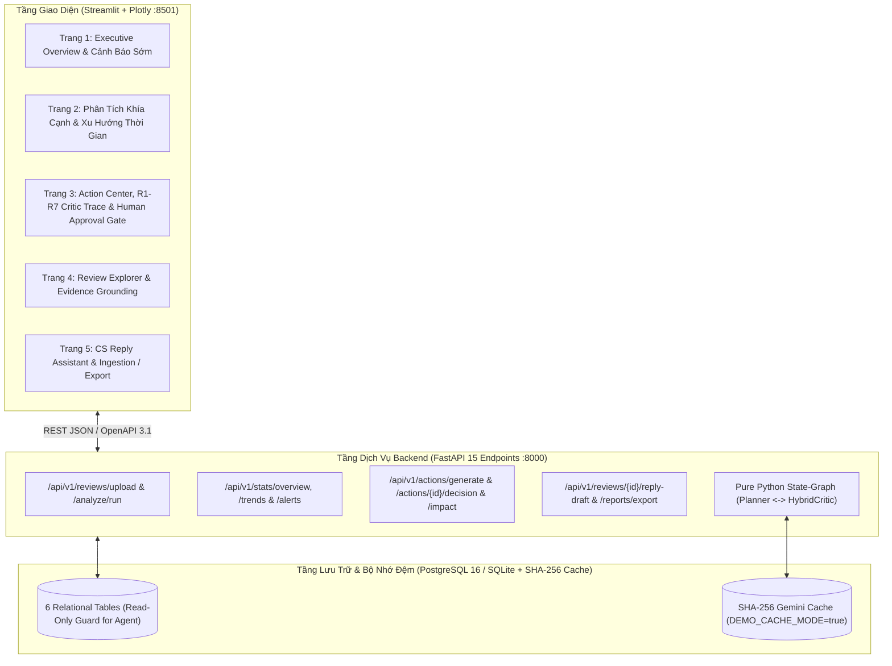

# Chương 3 (Phần 4): Kiến Trúc Sản Phẩm Full-Stack — Dịch Vụ RESTful FastAPI, Giao Diện Streamlit Đa Trang Và Đóng Gói Docker Compose 1-Click

## 3.11. Kiến Trúc Tổng Thể Hệ Thống 3 Tầng (`db`, `api`, `ui`)

Để chuyển hóa các đóng góp nghiên cứu khoa học (RQ1, RQ2, RQ3) thành một hệ thống phần mềm sẵn sàng triển khai thực tế cho các doanh nghiệp vừa và nhỏ (SMEs), **EcomReview AI** được kiến trúc theo mô hình 3 dịch vụ độc lập điều phối qua `docker-compose.yml`:

---

## 3.12. Thiết Kế 15 RESTful Endpoints Chuẩn OpenAPI 3.1 (`src/ecomreview/api/main.py`)

Tầng Backend API (`docs/openapi.json`) cung cấp 15 điểm cuối (endpoints) bao phủ trọn vẹn vòng đời từ nạp dữ liệu thô đến phê duyệt hành động và kiểm soát tác động:

| STT | Phương Thức & Đường Dẫn | Chức Năng Nghiệp Vụ & Bảo Mật |
| :-: | :--- | :--- |
| 1 | `GET /api/v1/health` | Kiểm tra trạng thái sống của API, backend CSDL (`sqlite`/`postgres`) và chế độ `demo_cache_mode`. |
| 2 | `POST /api/v1/reviews/upload` | Nạp lô đánh giá mới, tự động ẩn danh PII (`scrub_pii`) và chuẩn hóa ngôn ngữ mạng (`normalize_social_text`). |
| 3 | `POST /api/v1/analyze/run` | Kích hoạt trích xuất ABSA (A1 Gemini v2 / B1 / B2 / B3), hỗ trợ bất đồng bộ `async_mode=true` (Background Job). |
| 4 | `GET /api/v1/jobs/{job_id}` | Truy vấn trạng thái tiến trình và nhật ký kiểm toán từ bảng `system_jobs_audit`. |
| 5 | `GET /api/v1/stats/overview` | Trả về KPI tổng quan, thống kê khía cạnh kèm **Khoảng tin cậy bất đối xứng Wilson 95% CI**, chênh lệch sàn và phàn nàn ẩn. |
| 6 | `GET /api/v1/insights` | Truy xuất danh sách nhận định kinh doanh đã qua kiểm chứng số học `verify_numbers_in_statement`. |
| 7 | `POST /api/v1/actions/generate` | Thực thi đồ thị trạng thái `EcomReviewGraphRunner` (`Planner ⇄ HybridCritic` + `Auto-Repair`). |
| 8 | `GET /api/v1/actions` | Liệt kê các đề xuất hành động theo phân nhóm Marketing (`is_marketing = True`) hoặc Vận hành (`is_marketing = False`). |
| 9 | `POST /api/v1/actions/{action_id}/decision` | Ghi nhận quyết định của chủ shop (`APPROVED`, `EDITED`, `REJECTED`), lưu `decided_by` và tính `edit_distance_chars`. |
| 10 | `GET /api/v1/reviews` | Truy vấn đánh giá gốc và trích dẫn bằng chứng (tối ưu hóa giải quyết dứt điểm N+1 query). |
| 11 | `GET /api/v1/trends` | Trích xuất chuỗi thời gian xu hướng theo tháng/tuần/ngày và tỷ lệ phàn nàn theo khía cạnh. |
| 12 | `GET /api/v1/alerts` | Cảnh báo sớm (`HIGH`/`MEDIUM`/`WATCH`) dựa trên kiểm định thống kê **two-proportion z-test** ($p < 0.05$). |
| 13 | `POST /api/v1/reviews/{review_id}/reply-draft` | Trợ lý soạn thảo phản hồi CSKH tự động tuân thủ 6 Guardrails (`G1–G6`) bảo vệ chính sách sàn. |
| 14 | `GET /api/v1/actions/{action_id}/impact` | Đo lường hiệu quả trước/sau khi can thiệp hành động marketing / sản phẩm (`Intervention Impact`). |
| 15 | `GET /api/v1/reports/export` | Xuất Báo cáo Điều hành toàn diện dưới định dạng **Excel 6 sheet (`.xlsx`)** hoặc **HTML in PDF**. |

---

## 3.13. Thiết Kế Giao Diện 5 Trang Trực Quan & Cơ Chế *Human-in-the-Loop Approval Gate*

Giao diện người dùng (`src/ecomreview/ui/app.py`) được thiết kế chuyên biệt cho chủ shop TMĐT với 5 trang chức năng:
1. **Trang 1 — Tổng Quan Điều Hành & Cảnh Báo Sớm (`Executive Overview & Early Warning`):** Hiển thị 4 thẻ chỉ số KPI chủ đạo, biểu đồ thanh ngang Plotly tích hợp **Thanh sai số bất đối xứng (Asymmetric Wilson 95% CI Error Bars)** và hộp thông báo cảnh báo sớm phát hiện bùng phát lỗi bằng two-proportion z-test ($p < 0.05$).
2. **Trang 2 — Phân Tích Khía Cạnh & Xu Hướng (`Aspect Trends & Platform Gap`):** Trực quan hóa xu hướng tỷ lệ tiêu cực theo thời gian thực (Plotly line charts) và ma trận so sánh khác biệt hành vi khách hàng giữa Shopee và TikTok Shop.
3. **Trang 3 — Trung Tâm Hành Động & Kiểm Định (`Action Center & Critic Trace`):** Tách biệt rõ tab **Hành động Marketing (`is_marketing = True`)** và **Hành động Sản phẩm/Vận hành (`is_marketing = False`)**, hiển thị điểm ưu tiên `priority_score`, vết kiểm định 7 quy tắc R1–R7, đo lường can thiệp trước/sau (`Intervention Impact`) và 3 nút quyết định (`Approve`, `Edit & Approve`, `Reject`) kèm định danh người duyệt `decided_by`.
4. **Trang 4 — Khám Phá Đánh Giá & Bằng Chứng (`Review Explorer & Evidence Grounding`):** Cho phép lọc nhanh các đánh giá tiêu cực/ẩn trên Shopee và TikTok Shop, kiểm tra trích dẫn nguyên văn và bằng chứng trích xuất.
5. **Trang 5 — Hỗ Trợ CSKH & Nạp Dữ Liệu / Xuất Báo Cáo (`CS Reply Assistant & Ingest / Export`):** Trợ lý phản hồi khách hàng thông minh tuân thủ 6 Guardrails (`G1–G6`), bộ nạp file CSV/Excel kéo-thả, và công cụ xuất Báo cáo Điều hành Excel 6 sheet (`.xlsx`) cùng HTML tối ưu in PDF.

---

## 3.14. Chế Độ `DEMO_CACHE_MODE` & Tối Ưu Hóa Đóng Gói Docker (`requirements-docker.txt`)

Nhằm đảm bảo quá trình chấm thử và bảo vệ đồ án diễn ra tức thì, không phụ thuộc vào hạn ngạch mạng hay GPU:
- **Tách biệt `requirements-docker.txt`:** Loại bỏ các thư viện huấn luyện nặng (`torch`, `transformers`) khỏi container `api` và `ui`, giảm dung lượng Docker image từ $> 4.5\text{ GB}$ xuống $< 450\text{ MB}$ và rút ngắn thời gian `docker compose up --build` xuống dưới 60 giây.
- **Chế độ `DEMO_CACHE_MODE=true`:** Tận dụng 100% bộ đệm phản hồi SHA-256 (`data/cache/gemini_*.json`) và cơ sở dữ liệu đã nạp sẵn bởi `scripts/seed_demo.py`, đảm bảo thời gian phản hồi mọi thao tác trên giao diện luôn đạt $< 100\text{ ms}$ ngay cả khi ngắt kết nối Internet.

<!-- CreBy: MenBoyBMN -->

