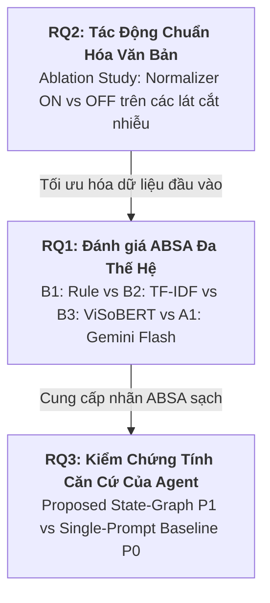

# Tài Liệu Đặc Tả Phạm Vi Nghiên Cứu & Kiến Trúc Đề Tài (Scope Document)

> **Tên đề tài:** EcomReview AI — Hệ thống AI Agent tự động phân tích phản hồi khách hàng tiếng Việt và đề xuất hành động marketing cho doanh nghiệp nhỏ  
> **Phiên bản:** 1.0.0  
> **Tác giả:** Kỹ sư kiêm Nghiên cứu viên dự án EcomReview AI  

---

## 1. Bối Cảnh Thực Tiễn & Định Nghĩa Bài Toán (Problem Statement)

### 1.1. Bối cảnh thị trường Thương mại Điện tử (TMĐT) Việt Nam
Tại Việt Nam, sự bùng nổ của các nền tảng TMĐT và Social Commerce như **Shopee** và **TikTok Shop** đã biến đánh giá của người mua (Customer Reviews) và bình luận tương tác (Comments) thành tài sản dữ liệu sống còn đối với các doanh nghiệp vừa và nhỏ (SMEs). Tuy nhiên, các nhà bán hàng hiện nay đang đối mặt với các rào cản nghiêm trọng:
1. **Dữ liệu phi cấu trúc, độ nhiễu cực cao:** Phản hồi của người tiêu dùng Việt Nam đặc trưng bởi ngôn ngữ mạng (teencode, từ viết tắt, tiếng lóng địa phương, văn bản không dấu, lạm dụng emoji và nghệ thuật mỉa mai ngầm/sarcasm).
2. **Khoảng cách từ Dữ liệu đến Hành động (Insight-to-Action Gap):** Các công cụ Social Listening hiện có chủ yếu dừng lại ở việc gán nhãn tích cực/tiêu cực toàn bài (Document-level Sentiment) hoặc đếm tần suất từ khóa đơn giản. Nhà bán lẻ không biết chính xác *thuộc tính nào* bị phàn nàn và *cần làm gì cụ thể* (sửa mô tả gian hàng, quay video giải thích, hay đổi chất liệu) để chặn đà giảm sút doanh số.
3. **Ảo tưởng số liệu (Hallucination) từ mô hình ngôn ngữ lớn (LLM):** Khi yêu cầu các chatbot AI hiện nay tổng hợp phản hồi, chúng thường tự bịa ra tỷ lệ phần trăm (ví dụ: "70% khách chê áo ngắn") mà không thể truy vết bằng chứng hay đối soát với cơ sở dữ liệu xác thực.

### 1.2. Định nghĩa Bài toán Kép (Dual-Objective Problem)
EcomReview AI giải quyết bài toán kép thông qua:
- **Tầng NLP (Phân tích khía cạnh - ABSA):** Chuyển đổi phản hồi phi cấu trúc thành bộ ba có căn cứ: `(Khía cạnh - Aspect, Cực tính - Polarity, Bằng chứng nguyên văn - Evidence)`.
- **Tầng AI Agent (Quyết sách hành động):** Sử dụng vòng lặp trạng thái có kiểm chứng (`SQL Aggregator` $\rightarrow$ `Insight Engine` $\rightarrow$ `Action Planner` $\rightleftarrows$ `Hybrid Critic`) để sinh các đề xuất marketing và vận hành cụ thể, kèm bằng chứng thực tế và tỷ lệ thống kê được kiểm định tin cậy (Wilson Score Interval).

---

## 2. Ba Câu Hỏi Nghiên Cứu (Research Questions) & Giả Thuyết Khoa Học

Hệ thống được thiết kế nhằm trả lời 3 câu hỏi nghiên cứu (RQ1–RQ3) có tính liên kết chặt chẽ từ tầng xử lý ngôn ngữ tự nhiên đến tầng đại lý thông minh:

### 2.1. RQ1: Đánh giá Hiệu năng Phân tích Cảm xúc theo Khía cạnh (ABSA) Đa Thế hệ & Hiện tượng Chuyển Miền (Domain Shift)
- **Câu hỏi nghiên cứu:** Khi phân tích phản hồi TMĐT tiếng Việt, mô hình ngôn ngữ lớn hiện đại (Gemini Flash few-shot với Structured Output) so với 3 thế hệ mô hình đường cơ sở (Rule-based Lexicon, TF-IDF + Logistic Regression, Pretrained Transformer ViSoBERT fine-tuned) đạt hiệu quả ra sao về độ chính xác (Macro-F1), chi phí tính toán, độ trễ và khả năng thích nghi khi chuyển từ tập chuẩn chung sang miền hẹp (Shop Áo Mưa)?
- **Giả thuyết (H1):** Trên tập Benchmark công khai cùng miền (In-domain), ViSoBERT fine-tuned và Gemini Flash có hiệu năng Macro-F1 tương đương nhau; tuy nhiên khi chuyển sang dữ liệu thực tế Shop Áo Mưa (Domain Shift / Zero-shot), Gemini Flash vượt trội đáng kể về Macro-F1 khía cạnh và khả năng trích xuất chính xác bằng chứng nguyên văn (`evidence`).
- **Chỉ số đo lường (Metrics):**
  - Macro-F1 Cảm xúc tổng thể (3 lớp: `positive`, `negative`, `neutral`).
  - Macro-F1 Khía cạnh - Cực tính (Aspect-Polarity 4 lớp: None, Pos, Neg, Neu).
  - Khoảng tin cậy Bootstrap CI 95% ($B = 1.000$).
  - Độ trễ trung bình (ms/review) và Ước tính chi phí inference ($/1.000 reviews).

### 2.2. RQ2: Đóng Góp Thực Nghiệm Của Bộ Chuẩn Hóa Văn Bản Tiếng Việt Mạng Xã Hội (Social Text Normalizer Ablation)
- **Câu hỏi nghiên cứu:** Module tiền xử lý và chuẩn hóa văn bản mạng xã hội (giải mã teencode, chuẩn hóa dấu thanh Unicode NFC, rút gọn ký tự lặp, phiên dịch emoji sang token cảm xúc) tác động thế nào đến từng dòng mô hình và từng lát cắt dữ liệu nhiễu?
- **Giả thuyết (H2):** Bộ chuẩn hóa giúp cải thiện $\Delta\text{F1}$ vượt bậc ở các mô hình dựa trên từ vựng (Rule-based, TF-IDF) và trên các lát cắt phản hồi chứa nhiều teencode/không dấu; đối với LLM, bộ chuẩn hóa giúp giảm thiểu hiện tượng ảo giác thực thể và nhận diện sai các từ viết tắt chuyên ngành.
- **Chỉ số đo lường (Metrics):**
  - $\Delta\text{Macro-F1} = \text{Macro-F1}_{\text{Normalizer ON}} - \text{Macro-F1}_{\text{Normalizer OFF}}$.
  - Đánh giá phân rã theo 3 lát cắt nhiễu: `has_teencode`, `is_no_diacritics`, `has_emoji`.

### 2.3. RQ3: Tính Căn Cứ (Groundedness), Khả Thi & An Toàn Của Kiến Trúc Agent Đa Bước Có Phê Bình
- **Câu hỏi nghiên cứu:** Kiến trúc Agent đa bước có kiểm chứng (`Aggregator SQL` $\rightarrow$ `Insight Engine` $\rightarrow$ `Action Planner` $\rightleftarrows$ `Hybrid Critic`) có tạo ra các đề xuất hành động marketing và chăm sóc khách hàng có căn cứ xác thực, khả thi và an toàn hơn đáng kể so với phương pháp gọi LLM một bước (Single-Prompt Baseline P0) không?
- **Giả thuyết (H3):** Hệ thống đề xuất (P1) triệt tiêu hoàn toàn lỗi bịa số liệu (`Number Consistency` đạt 100%), đạt tỷ lệ trích dẫn bằng chứng hợp lệ (`Evidence Validity`) $\ge 95\%$, và vượt trội baseline P0 về điểm đánh giá Rubric mù (Mù đôi - Blind Evaluation) từ chuyên gia nghiệp vụ trên 5 tiêu chí.
- **Chỉ số đo lường (Metrics):**
  - **Định lượng tự động:** Number Consistency (%), Evidence Validity (%), Quote Fidelity (%), Safety Pass Rate (%).
  - **Chuyên gia / Rubric mù (Thang 1–5):** Actionability (Khả thi), Grounding (Căn cứ), Specificity (Tính cụ thể), Channel Fit (Phù hợp kênh), Tone & Safety (Văn phong & An toàn).

---

## 3. Ranh Giới Hệ Thống (In-Scope vs. Out-of-Scope)

Nhằm đảm bảo tính tập trung cao độ cho mục tiêu nghiên cứu và chất lượng sản phẩm trong thời gian 10 tuần, ranh giới dự án được xác định rõ:

### 3.1. Trong phạm vi (In-Scope)
- Tiếp nhận và làm sạch dữ liệu phản hồi dạng bảng (CSV/Excel) từ Shopee và TikTok Shop.
- Tự động khử khuẩn dữ liệu nhạy cảm cá nhân (PII: Số điện thoại, Email, Địa chỉ giao hàng).
- Phòng thủ 4 lớp trước tấn công chèn lệnh (Prompt Injection Defense).
- Phân tích cảm xúc theo 8 khía cạnh chuẩn mực ngành hàng E-commerce/Áo mưa.
- Lưu trữ cấu trúc hóa trên PostgreSQL 16; tổng hợp chỉ số với khoảng tin cậy Wilson Score.
- Agent tự động lập kế hoạch hành động marketing và vận hành dựa trên Playbook chuyên ngành.
- Hybrid Critic (7 quy tắc xác định R1–R7 + LLM-Judge) thẩm định và phản hồi lặp (`Planner ⇄ Critic`).
- Cổng phê duyệt con người (Human-in-the-Loop Approval Gate) trên giao diện Streamlit.
- Đóng gói container Docker Compose 1-click triển khai sẵn sàng.

### 3.2. Ngoài phạm vi (Out-of-Scope)
- **Không tự động cào dữ liệu ngầm (No Unauthorized Web Scraping):** Chỉ làm việc trên dữ liệu xuất chính thức từ sàn hoặc tập dữ liệu nghiên cứu công khai.
- **Không tự động đăng bài / gửi tin nhắn trực tiếp ra sàn:** Mọi hành động bắt buộc phải qua bước người dùng xét duyệt (Human Approval Gate) để đảm bảo an toàn kinh doanh.
- **Không phát triển hệ thống phân quyền phức tạp (No Multi-tenant/RBAC/JWT):** Loại bỏ tính năng đăng nhập/đăng ký người dùng nhiều cấp để tập trung toàn lực vào trí tuệ nhân tạo, tính toán thống kê và kiểm chứng học thuật.

---

## 4. Các Nguy Cơ Ảnh Hưởng Tính Xác Thực (Threats to Validity) & Chiến Lược Giảm Thiểu

| Nguy cơ (Threat) | Loại nguy cơ | Chiến lược giảm thiểu trong EcomReview AI |
| :--- | :--- | :--- |
| **Cỡ mẫu Shop thật nhỏ (<100)** | Construct Validity | Áp dụng chiến lược dữ liệu kép (**Dual-Track**): Sử dụng Benchmark công khai (1.500+ mẫu) để đảm bảo ý nghĩa thống kê và Gold Set shop áo mưa cho kiểm thử thực tế và Case Study. |
| **Độ chệch chủ quan khi gán nhãn** | Internal Validity | Ban hành tài liệu hướng dẫn gán nhãn chi tiết ([annotation_guideline.md](file:///d:/DEV/DEV_Source_Project/2.Develoment_Project/EcomReview%20AI/EcomReview%20AI/docs/annotation_guideline.md)); kiểm tra độ đồng thuận liên người đánh giá bằng hệ số **Cohen's Kappa / Fleiss' Kappa** ($\kappa \ge 0.75$). |
| **Độ bất định của LLM (Stochasticity)** | Reliability | Cố định `temperature = 0.0` khi trích xuất thông tin; sử dụng Pydantic Structured Output; thiết lập Random Seed cố định (`seed = 42`) và kiểm định Bootstrap CI 95% ($B = 1.000$). |
| **Thiên kiến khi đánh giá Agent P0 vs P1** | Evaluation Bias | Áp dụng phương thức **Thử nghiệm Mù (Blind Evaluation)**: tráo ngẫu nhiên kết quả P0/P1 trước khi chấm điểm theo Rubric 5 tiêu chí. |
| **Dữ liệu độc hại (Prompt Injection)** | Security Risk | Kiến trúc phòng thủ đa tầng: Khử ký tự điều khiển, bọc dữ liệu trong thẻ XML `<customer_review>`, và truy cập cơ sở dữ liệu ở chế độ `READ-ONLY` đối với luồng phân tích. |

---

## 5. Bảng Ánh Xạ RQ $\rightarrow$ Thực Nghiệm $\rightarrow$ Báo Cáo Đồ Án

| Câu hỏi | Dữ liệu kiểm thử | Phương pháp & Mô hình | Bảng kết quả dự kiến | Chương báo cáo |
| :--- | :--- | :--- | :--- | :--- |
| **RQ1** | Public Benchmark + Gold Shop Áo Mưa | B1 (Rule), B2 (TF-IDF), B3 (ViSoBERT), A1 (Gemini Flash) | Bảng so sánh Macro-F1, Latency, Cost + Bootstrap CI 95% | Chương 3 & Chương 4 |
| **RQ2** | Benchmark cắt lát: Teencode, Không dấu, Emoji | Bật / Tắt Vietnamese Social Text Normalizer | Bảng $\Delta\text{Macro-F1}$ phân rã theo nhóm nhiễu | Chương 4 |
| **RQ3** | 10 Kịch bản thực tế của Shop Áo Mưa | Baseline P0 (Single-Prompt) vs Proposed P1 (State-Graph) | Bảng tỷ lệ Groundedness (100%), Biểu đồ Radar Rubric mù | Chương 4 & Chương 5 |

<!-- CreBy: MenBoyBMN -->
